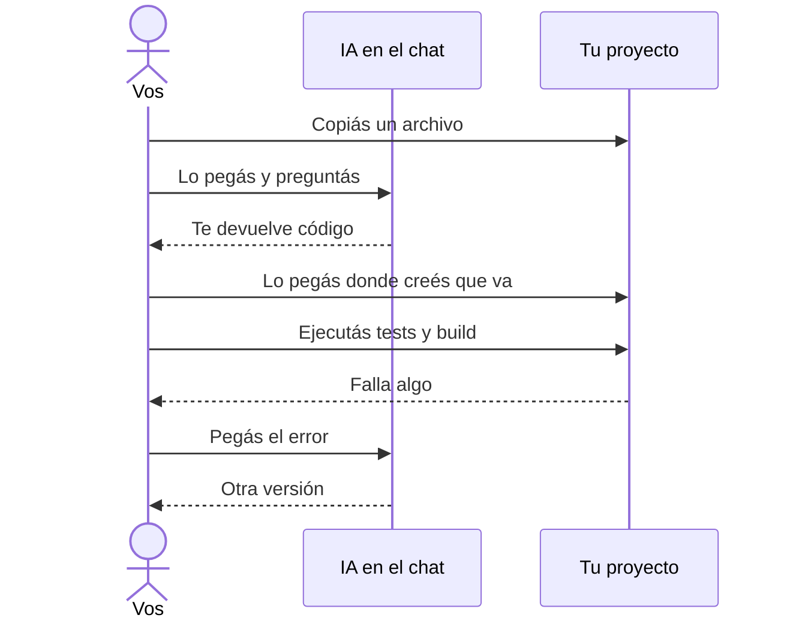
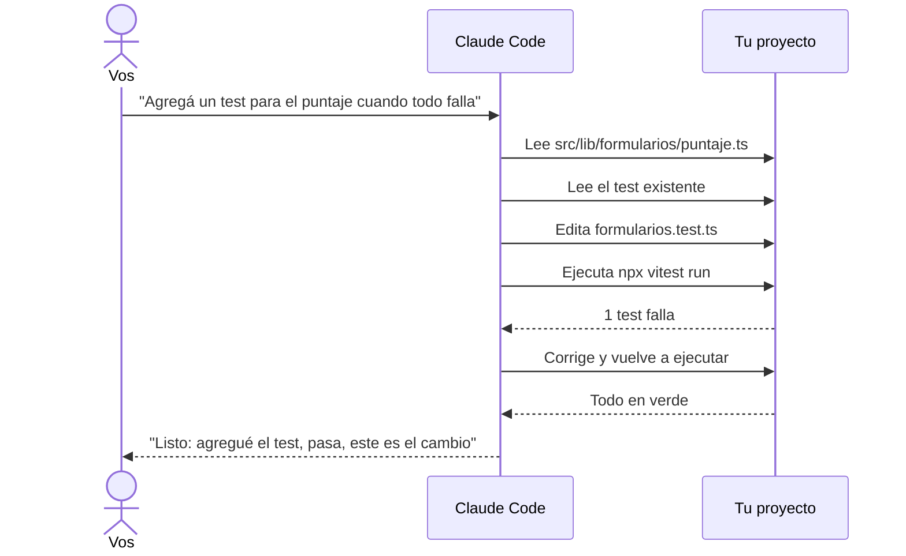
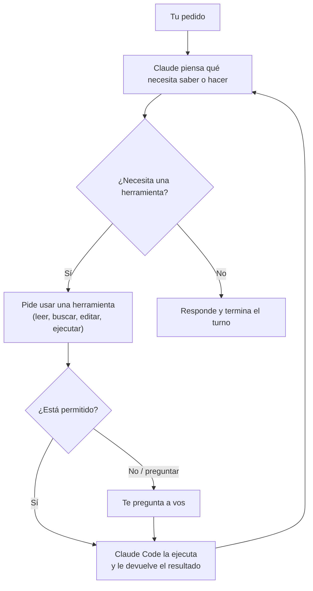
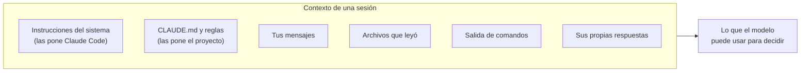
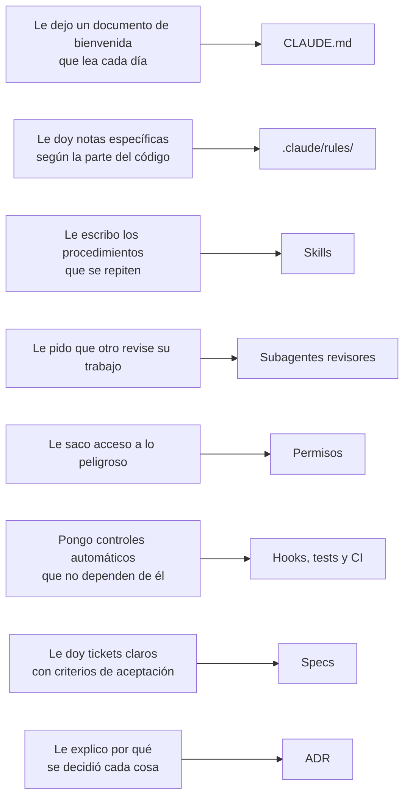

# 1 · De chatear a trabajar con un agente

Usar la IA como chat y trabajar con un agente parecen lo mismo, pero no lo
son. En el chat, vos sos el que mira el proyecto, copia, pega y ejecuta. Un
agente hace todo eso por su cuenta dentro de tu repositorio. Este capítulo
explica qué cambia, cómo "piensa" un agente y por qué hace falta darle
estructura.

## 1.1 El chat: vos sos el intermediario

Así trabaja casi todo el mundo con la IA al principio:

Funciona, pero tiene límites:

- La IA solo ve lo que vos le pegás. No conoce el resto del proyecto, las
  convenciones ni los tests.
- Cada error vuelve a pasar por vos.
- Cuando cerrás la conversación, todo lo que le explicaste se pierde.

## 1.2 El agente: la IA trabaja dentro del proyecto

Un **agente** es un modelo de IA al que se le dan **herramientas**: leer
archivos, buscar texto, editar, ejecutar comandos en la terminal. Claude Code
es eso: un programa que corre en tu máquina, dentro de la carpeta del
proyecto, y le presta esas herramientas a Claude.

Vos pasás de ser el intermediario a ser quien **define qué se quiere y revisa
el resultado**. Es parecido a pasar de programar solo a liderar a un
desarrollador muy rápido.

## 1.3 Cómo funciona por dentro: el ciclo del agente

Un agente no "ejecuta un plan" de una sola vez. Repite un ciclo corto hasta
que considera que terminó:

Si venís de programar APIs, pensalo así: el modelo no tiene acceso directo a
tu disco. Lo que hace es **pedir** "quiero llamar a `Edit` con estos
parámetros", y Claude Code decide si lo ejecuta (según los permisos), lo
ejecuta y le devuelve el resultado. Las herramientas son como endpoints que
el modelo puede invocar.

Las herramientas que vas a ver todo el tiempo:

| Herramienta | Qué hace                                     | Equivalente manual          |
| ----------- | -------------------------------------------- | --------------------------- |
| `Read`      | Lee un archivo                               | Abrirlo en el editor        |
| `Grep`      | Busca texto en el proyecto                   | Ctrl+Shift+F                |
| `Glob`      | Lista archivos por patrón (`src/**/*.ts`)    | Explorador de archivos      |
| `Edit`      | Reemplaza un fragmento de un archivo         | Editar y guardar            |
| `Write`     | Crea o sobrescribe un archivo completo       | Archivo nuevo               |
| `Bash`      | Ejecuta un comando en la terminal            | `npm test`, `git diff`      |
| `Agent`     | Delega una tarea a un subagente (capítulo 5) | Pedirle algo a un compañero |

## 1.4 El concepto más importante: el contexto

El **contexto** es todo lo que el modelo tiene "a la vista" en una sesión:
tus mensajes, sus respuestas, los archivos que leyó, la salida de los
comandos y las instrucciones del proyecto. Es su memoria de trabajo, y tiene
dos propiedades que lo explican casi todo:

1. **Lo que no está en el contexto, no existe para el modelo.** Si nunca leyó
   `docs/contenido/experiencia.md`, no sabe tus fechas reales.
2. **Cada sesión nueva empieza vacía.** Lo que le explicaste ayer se perdió,
   salvo que esté escrito en un archivo que se cargue solo.

El contexto también tiene un **tamaño máximo**. En sesiones largas se llena
de lecturas y salidas viejas, y Claude Code lo resume automáticamente. Por
eso conviene una sesión por tarea (lo vemos en el capítulo 15).

## 1.5 Por qué un agente se equivoca

Un modelo de lenguaje produce la respuesta **más probable** dado lo que tiene
en el contexto. Cuando falta información, no se queda quieto: completa el
hueco con algo plausible. Eso, en un proyecto, se ve así:

| Falta en el contexto                     | Lo que el agente hace                      |
| ---------------------------------------- | ------------------------------------------ |
| Tus fechas reales de trabajo             | Inventa unas razonables                    |
| Que el repo es público                   | Escribe el nombre de un cliente en un caso |
| Que la home no debe cargar React         | Agrega una isla en la home                 |
| Cómo se verifica que algo está terminado | Dice "listo" sin correr el build           |
| Qué quedó fuera del pedido               | Agrega funcionalidades que nadie pidió     |

Ninguno de esos errores es "falta de inteligencia": es **falta de
contexto**. Toda la estructura de este repositorio existe para que ese
contexto esté siempre disponible y para frenar automáticamente lo que no
puede pasar.

## 1.6 La analogía que ordena todo

Imaginá que contratás a un desarrollador senior, muy rápido, que **pierde la
memoria cada mañana**. ¿Qué harías?

Los próximos capítulos recorren cada una de esas piezas.

## Resumen

- Un agente usa herramientas para leer, editar y ejecutar dentro del proyecto.
- Trabaja en un ciclo: piensa → usa una herramienta → mira el resultado → repite.
- Solo sabe lo que está en su contexto, y el contexto se vacía en cada sesión.
- Cuando falta información, completa con lo probable: por eso hace falta estructura.

Siguiente: [2 · Primeros pasos con Claude Code](02-primeros-pasos.md)
