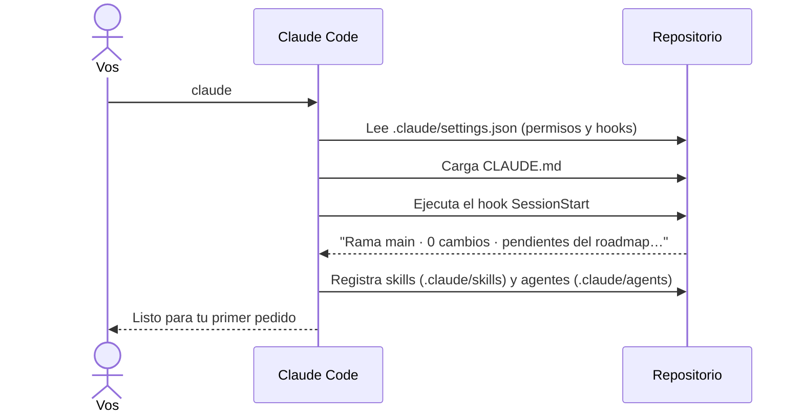
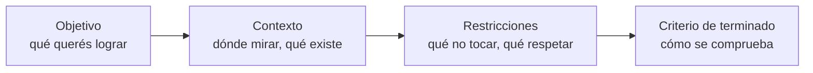

# 2 · Primeros pasos con Claude Code

Este capítulo cubre lo práctico: cómo se instala Claude Code, cómo se abre en
el proyecto, qué significan los avisos de permisos, los atajos que se usan
todo el tiempo y, sobre todo, cómo escribir un pedido para que el resultado
salga bien a la primera.

## 2.1 Instalación

Necesitás una cuenta de Claude con acceso a Claude Code (o una API key). En
Windows, Claude Code usa **Git Bash** para ejecutar comandos, así que tiene
que estar instalado Git for Windows.

Hay un instalador nativo (la opción recomendada) y también un paquete de
npm, que requiere Node.js 18 o superior:

```bash
# Instalador nativo — macOS, Linux o Git Bash
curl -fsSL https://claude.ai/install.sh | bash

# Instalador nativo — PowerShell en Windows
irm https://claude.ai/install.ps1 | iex

# Alternativa con npm
npm install -g @anthropic-ai/claude-code
```

Los métodos de instalación cambian con el tiempo: antes de instalar, revisá
la documentación oficial de Claude Code (https://docs.claude.com). También
hay extensiones para VS Code y JetBrains. La
primera vez que lo abrís te pide iniciar sesión. El paso a paso completo de
la instalación (con Node, Git y las cuentas) está en el
[capítulo 7](07-preparar-el-entorno.md).

### Un laboratorio para practicar

Las prácticas de estos capítulos usan el repositorio de este portfolio como
laboratorio: cuando dicen "este repo", hablan de él. Clonalo en una carpeta
aparte para poder probar sin miedo:

```bash
git clone https://github.com/patricioprp/portfolio.git portfolio-referencia
cd portfolio-referencia
npm install
```

## 2.2 Abrir una sesión

Una **sesión** es una conversación con Claude dentro de una carpeta. Se abre
desde la terminal, parado en la raíz del proyecto:

```bash
cd portfolio-referencia
claude
```

Al arrancar pasan cosas que no ves pero que importan:



Para retomar una sesión anterior: `claude -c` (continúa la última) o
`claude --resume` (elegís cuál).

## 2.3 Los avisos de permisos

Cuando Claude quiere hacer algo que no está pre-autorizado (por ejemplo,
editar un archivo o ejecutar un comando nuevo), te pregunta. Las opciones
típicas son:

| Opción                      | Qué significa                                                    |
| --------------------------- | ---------------------------------------------------------------- |
| Sí                          | Lo permite esta vez                                              |
| Sí, y no volver a preguntar | Lo permite para el resto de la sesión (o lo guarda como permiso) |
| No (y explicar qué hacer)   | Lo frena; podés escribirle por qué y qué hacer en su lugar       |

Leé siempre el comando antes de aceptar. En este repo, lo seguro y frecuente
(`npm test`, `npm run build`, `git diff`) ya está autorizado en
`.claude/settings.json`, y lo peligroso (`git push`, borrar carpetas, leer
`.env`) está prohibido. Lo vemos en el capítulo 4.

## 2.4 Modos de trabajo

Con **Shift+Tab** cambiás de modo. El modo actual se ve debajo del cuadro de
texto. Los que más vas a usar:

| Modo                  | Qué hace                                                     | Cuándo usarlo                                              |
| --------------------- | ------------------------------------------------------------ | ---------------------------------------------------------- |
| **Normal**            | Pide permiso para editar y para comandos no autorizados      | Mientras aprendés y en tareas delicadas                    |
| **Plan**              | Solo investiga y te presenta un plan; no edita nada          | Antes de un cambio grande o cuando no está claro el camino |
| **Aceptar ediciones** | Edita sin preguntar (los comandos siguen sujetos a permisos) | Tareas mecánicas en las que ya confiás                     |

El **modo plan** es el mejor aliado al principio: le pedís algo, Claude lee
el código y te muestra qué piensa hacer. Si el plan no te convence, lo
corregís antes de que haya tocado un solo archivo.

## 2.5 Atajos y comandos útiles

| Atajo / comando         | Para qué                                                                       |
| ----------------------- | ------------------------------------------------------------------------------ |
| `@ruta/archivo`         | Mencionar un archivo para que lo lea (`@docs/specs/003-demo-contingencias.md`) |
| `!comando`              | Ejecutar un comando vos mismo y que la salida quede en la conversación         |
| `Esc`                   | Interrumpir a Claude en lo que esté haciendo                                   |
| `Esc` `Esc` o `/rewind` | Volver a un mensaje anterior (y, opcionalmente, deshacer los cambios)          |
| `/clear`                | Vaciar el contexto y empezar una tarea nueva                                   |
| `/compact`              | Resumir la conversación para liberar contexto sin perder el hilo               |
| `/context`              | Ver cuánto contexto está ocupado y en qué                                      |
| `/init`                 | Generar un `CLAUDE.md` inicial en un proyecto nuevo                            |
| `/memory`               | Abrir y editar los archivos de memoria (`CLAUDE.md`)                           |
| `/permissions`          | Ver y editar los permisos                                                      |
| `/hooks`                | Ver los hooks configurados                                                     |
| `/agents`               | Ver y crear subagentes                                                         |
| `/model`                | Cambiar de modelo                                                              |
| `/help`                 | Lista completa                                                                 |
| `/verificar`, `/spec`…  | Skills de este proyecto (capítulo 5)                                           |

## 2.6 Cómo pedir las cosas

La diferencia entre un buen y un mal resultado casi siempre está en el
pedido. Un buen pedido tiene cuatro partes:



Ejemplo con este proyecto:

| Pedido flojo                   | Pedido bueno                                                                                                                                                                                                    |
| ------------------------------ | --------------------------------------------------------------------------------------------------------------------------------------------------------------------------------------------------------------- |
| "Arreglá el mapa que anda mal" | "En la demo del mapa (`src/islands/mapa/`), al hacer zoom con el teclado el foco se pierde. Reproducilo con un test e2e en `e2e/demo-mapa.spec.ts`, corregilo sin cambiar `src/lib/mapa` y corré `/verificar`." |
| "Agregá mi trabajo nuevo"      | "`/nueva-experiencia` Entré a una empresa como Tech Lead en marzo (ejemplo ficticio)."                                                                                                                          |
| "Mejorá la home"               | "Usá el modo plan. Quiero que la sección de demos se entienda mejor en mobile. Leé `docs/PRODUCTO.md` y proponeme dos alternativas antes de tocar código."                                                      |

Reglas prácticas:

- **Señalá archivos** con `@` o con la ruta: ahorra búsquedas y errores.
- **Decí cómo se verifica:** "que pase `npx vitest run src/lib/mapa`".
- **Una tarea por vez.** Si mezclás tres pedidos, el resultado mezcla tres cosas.
- **Si algo es ambiguo, pedile que pregunte:** "si te falta un dato, preguntame antes".

## 2.7 Revisar lo que hizo

Claude te muestra cada edición como un _diff_ (líneas agregadas y quitadas).
Al final de una tarea, revisá el conjunto:

```bash
git status      # qué archivos cambiaron
git diff        # qué cambió en cada uno
```

En este repo, además, el skill `/verificar` corre formato, lint, tipos,
tests, build y e2e. Nada se commitea sin que vos lo pidas.

## 2.8 Práctica guiada

Hacé esto en este repositorio para perderle el miedo:

1. Abrí `claude` en la raíz. Mirá el mensaje del hook de inicio con los pendientes.
2. Pasá a modo plan (Shift+Tab) y pedí: _"Explicame cómo se calcula el
   puntaje en la demo del formulario dinámico, con los archivos involucrados."_
3. Volvé a modo normal y pedí: _"Agregá un test en `src/lib/mapa/mapa.test.ts`
   que compruebe que `distanciaKm` de un punto a sí mismo es 0. Corré solo
   ese archivo."_
4. Mirá el diff y el resultado del test.
5. Si no te convence, `Esc` `Esc` para volver atrás, o pedile que lo deshaga.

## Resumen

- `claude` en la raíz abre una sesión; al arrancar carga permisos, hooks,
  `CLAUDE.md`, skills y agentes.
- Shift+Tab cambia de modo; el modo plan propone antes de editar.
- Un buen pedido tiene objetivo, contexto, restricciones y criterio de terminado.
- Siempre se revisa el diff; `/verificar` comprueba que todo siga funcionando.

Anterior: [1 · De chatear a un agente](01-de-chatear-a-un-agente.md) ·
Siguiente: [3 · Contexto persistente](03-contexto-persistente.md)
