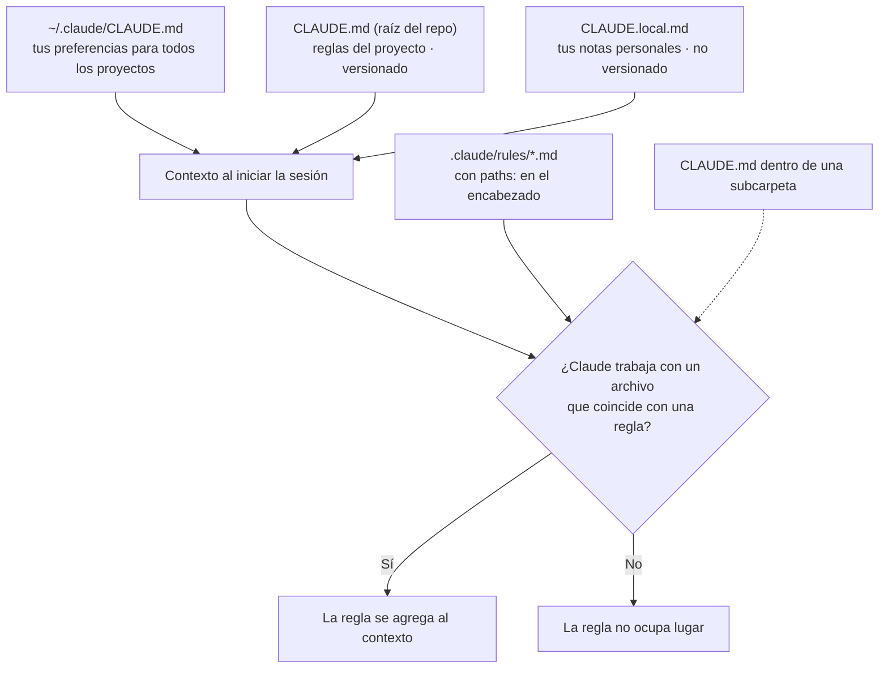

# 3 · Contexto persistente: CLAUDE.md y reglas

Como cada sesión empieza con el contexto vacío, el proyecto necesita una
forma de "presentarse" solo. Para eso están `CLAUDE.md` (lo que aplica
siempre) y `.claude/rules/` (lo que aplica a una parte del código). Este
capítulo explica cómo se cargan, qué contienen en este repo y cómo escribir
instrucciones que el modelo realmente siga.

## 3.1 Qué es `CLAUDE.md`

Es un archivo Markdown que Claude Code carga **automáticamente al comienzo
de cada sesión**, antes de tu primer mensaje. Es el documento de bienvenida
del capítulo 1: qué es el proyecto, cómo se trabaja, qué no se hace nunca.

No tiene sintaxis especial: es texto. Lo que importa es **qué** se escribe y
**cómo**.

## 3.2 Todos los lugares de donde se cargan instrucciones



| Archivo               | Alcance                            | ¿Va a git?        | Uso en este repo                   |
| --------------------- | ---------------------------------- | ----------------- | ---------------------------------- |
| `~/.claude/CLAUDE.md` | Todos tus proyectos                | No                | No se usa                          |
| `CLAUDE.md`           | Este proyecto, siempre             | Sí                | Reglas globales del portfolio      |
| `CLAUDE.local.md`     | Este proyecto, solo tu máquina     | No (`.gitignore`) | Disponible para notas personales   |
| `.claude/rules/*.md`  | Archivos que coinciden con `paths` | Sí                | Lógica pura, islas, contenido, e2e |

Un detalle de esta máquina: en `C:\Users\ppolito\Desktop` hay **otro**
`CLAUDE.md` (de un proyecto de trabajo). Como el portfolio está dentro de esa
carpeta, Claude Code también lo carga. Por eso el `CLAUDE.md` del portfolio
empieza aclarando que ese otro archivo no aplica acá.

## 3.3 Recorrido por el `CLAUDE.md` de este repo

| Sección                     | Qué dice                                                        | Por qué está                                                         |
| --------------------------- | --------------------------------------------------------------- | -------------------------------------------------------------------- |
| Aviso inicial               | Que el `CLAUDE.md` del escritorio no aplica                     | Evitar que mezcle convenciones de otro proyecto                      |
| Qué es este proyecto        | Objetivo: empleo estable; diferencial: casos y demos            | Que cada decisión apunte al objetivo (nada de "servicios freelance") |
| Estado actual y Stack       | Fases terminadas, versiones y por qué TypeScript queda en 6     | Que no "actualice" algo que se fijó a propósito                      |
| Comandos                    | `npm run …` del proyecto                                        | Que use los comandos reales y no invente otros                       |
| Cómo trabajar               | Qué skill usar según el pedido                                  | Que siga el flujo (capítulo 7) sin que se lo recuerdes               |
| Fuente de verdad            | Todo texto sale de `docs/contenido/` y `docs/casos/`            | La regla que más errores evita: no inventar                          |
| Datos que nunca se publican | Referencias, credenciales, fecha de nacimiento, `docs/privado/` | El repo es público                                                   |
| Convenciones                | Idioma, Prettier, sin `any`, a11y, commits                      | Consistencia sin tener que repetirlo                                 |

Observá que **remite** a otros documentos (`docs/PRODUCTO.md`,
`docs/ARQUITECTURA.md`) en vez de copiarlos. Una sola fuente por tema evita
contradicciones, y Claude los lee cuando los necesita.

## 3.4 Reglas por carpeta (`.claude/rules/`)

Si todo fuera a `CLAUDE.md`, el archivo crecería sin control y cada sesión
cargaría instrucciones irrelevantes para la tarea. Las reglas resuelven eso:
cada archivo declara a qué rutas aplica.

```markdown
---
paths:
  - 'src/lib/**'
---

# Reglas para `src/lib/` (lógica de negocio)

- TypeScript puro: sin imports de React, Astro, `window` ni `document`.
- Las fechas se reciben por parámetro (`ahora: Date`), no con `new Date()`…
```

El bloque entre `---` es el _frontmatter_: metadatos en YAML. `paths` usa
patrones glob, los mismos que usás en `.gitignore` o en la config de ESLint.

| Regla            | Se activa en                                                                         | En una línea                                                 |
| ---------------- | ------------------------------------------------------------------------------------ | ------------------------------------------------------------ |
| `logica-pura.md` | `src/lib/**`                                                                         | TS puro, funciones puras, test primero, errores tipados      |
| `islas-react.md` | `src/islands/**`                                                                     | La isla dibuja; la lógica se importa; a11y y tokens del tema |
| `contenido.md`   | `src/content/**`, `src/i18n/**`, `src/data/**`, `docs/contenido/**`, `docs/casos/**` | No inventar, ES y EN siempre, clientes anónimos              |
| `tests-e2e.md`   | `e2e/**`, `playwright.config.ts`                                                     | Selectores accesibles, desktop y mobile, sin esperas fijas   |

Si venís de Laravel: es parecido a tener un `README` por módulo, con la
diferencia de que acá se lee solo, justo cuando tocás ese módulo.

## 3.5 Cómo escribir instrucciones que se cumplan

El modelo sigue mejor las instrucciones **concretas, verificables y con
motivo**. Comparación:

| Floja                             | Mejor                                                                                  | Por qué es mejor                           |
| --------------------------------- | -------------------------------------------------------------------------------------- | ------------------------------------------ |
| "Escribí código limpio"           | "La isla no calcula reglas de negocio: se importan de `src/lib/`"                      | Se puede comprobar mirando el código       |
| "Cuidá la privacidad"             | "Nunca nombres de empresas cliente en el sitio; usar 'prepaga líder a nivel nacional'" | Dice qué hacer en lugar de qué evitar      |
| "Usá buenas prácticas de testing" | "Test al lado del código: `<modulo>.test.ts`. Primero el test que falla"               | Indica dónde y en qué orden                |
| "No uses TS 7"                    | "TypeScript queda en `~6.0`: `typescript-eslint` todavía no soporta TS 7"              | Con el motivo, sabe cuándo deja de aplicar |

Otros consejos:

- **Corto.** Cada línea de `CLAUDE.md` se carga en todas las sesiones. Si una
  sección solo aplica a una carpeta, va a una regla.
- **Prohibiciones explícitas para lo grave.** "No inventes datos, fechas,
  clientes, métricas ni tecnologías" funciona mejor que "sé preciso".
- **Si algo es crítico, no alcanza con escribirlo:** necesita un control
  automático (capítulo 4).
- **Mantenelo vivo.** Si corregís a Claude dos veces por lo mismo, falta una
  línea en `CLAUDE.md` o en una regla.

## 3.6 ¿Y la "memoria" de Claude?

Además de estos archivos, Claude Code puede guardar notas propias entre
sesiones (memoria automática, fuera del repositorio). Es útil para
preferencias personales, pero **la fuente de verdad del proyecto es el
repositorio**: lo que importa para trabajar en él tiene que estar en
`CLAUDE.md`, en las reglas o en `docs/`, donde lo ve cualquiera y queda en git.

## 3.7 Práctica guiada

1. Abrí [`CLAUDE.md`](../../CLAUDE.md) y [`.claude/rules/`](../../.claude/rules/)
   y leelos completos: son cortos.
2. En una sesión nueva, pedí: _"¿Qué reglas aplican si edito
   `src/islands/mapa/Canje.tsx`?"_. Claude debería mencionar las de
   `islas-react.md`.
3. Para ver qué ocupa el contexto, escribí `/context`.

## Resumen

- `CLAUDE.md` se carga en cada sesión: es el documento de bienvenida del proyecto.
- `.claude/rules/` agrega instrucciones solo cuando se trabaja en ciertas rutas.
- Las buenas instrucciones son concretas, verificables y explican el motivo.
- Lo crítico necesita además un control automático.

Anterior: [2 · Primeros pasos](02-primeros-pasos.md) ·
Siguiente: [4 · Permisos y hooks](04-permisos-y-hooks.md)
