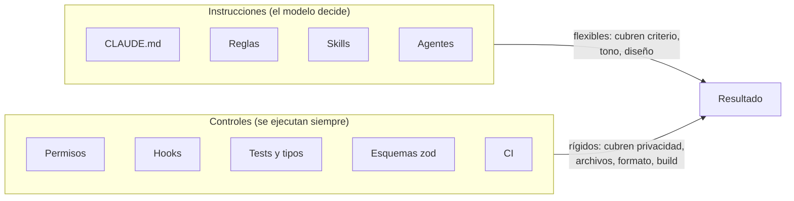
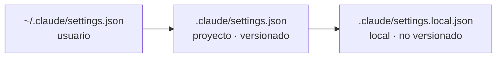
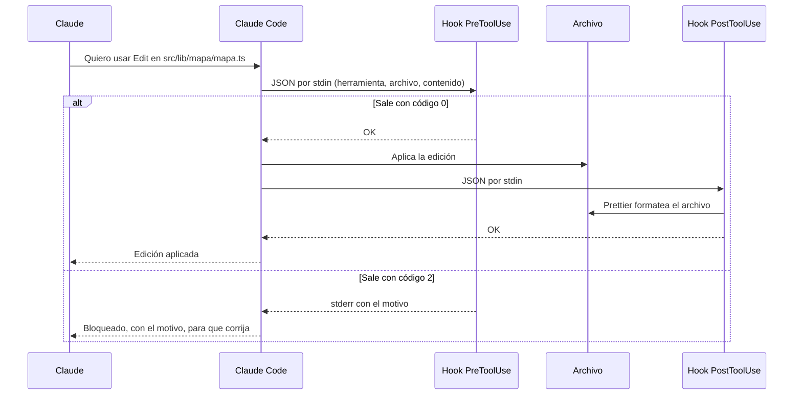
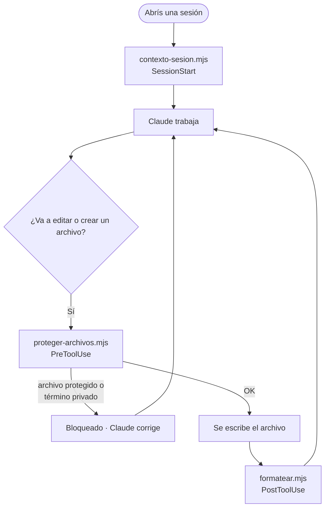

# 4 · Permisos y hooks: lo que no puede fallar

`CLAUDE.md` y las reglas son instrucciones: el modelo _debería_ seguirlas,
pero puede equivocarse. Para lo que no puede fallar se usan controles que se
ejecutan siempre, sin importar lo que el modelo decida: **permisos** (qué
puede hacer) y **hooks** (código que corre antes o después de cada acción).
Este capítulo explica los dos con los ejemplos reales del repo.

## 4.1 Instrucciones vs. controles



La pregunta para decidir dónde va algo: **¿qué pasa si el modelo se olvida
una vez?** Si la respuesta es "nada grave", alcanza con una instrucción. Si es
"se publica un dato privado" o "se rompe producción", necesita un control.

## 4.2 `.claude/settings.json`

Es la configuración de Claude Code para el proyecto. Se versiona, así que
aplica a cualquiera que trabaje en el repo. Hay tres niveles y el más
específico gana:



En este repo `settings.json` tiene dos secciones: `permissions` y `hooks`.

## 4.3 Permisos

```json
"permissions": {
  "allow": ["Bash(npm test)", "Bash(npm run build)", "Bash(git diff *)", "…"],
  "ask":   ["Bash(git commit *)", "Bash(npm install *)", "Bash(npm uninstall *)"],
  "deny":  ["Read(./.env)", "Bash(git push *)", "Bash(git reset --hard *)", "Bash(rm -rf *)"]
}
```

| Lista   | Efecto                                   | Criterio en este repo                                                    |
| ------- | ---------------------------------------- | ------------------------------------------------------------------------ |
| `allow` | Se ejecuta sin preguntar                 | Comandos frecuentes que no pueden romper nada: tests, build, `git diff`  |
| `ask`   | Siempre pregunta, aunque haya otra regla | Acciones con efecto real pero reversible: commitear, instalar paquetes   |
| `deny`  | Nunca se ejecuta                         | Irreversible o sensible: `git push` (publica el sitio), borrar, secretos |

La sintaxis es `Herramienta(patrón)`. El `*` funciona como comodín:
`Bash(git diff *)` permite `git diff`, `git diff --staged`, etc.

¿Por qué `git push` está prohibido? Porque Netlify despliega el sitio al
recibir un push. Publicar es una decisión tuya, no del agente.

Si venís de Laravel, pensalo como las _Gates_ y _Policies_: definen qué
acción puede hacer quién, antes de que la acción ocurra.

## 4.4 Hooks: middleware para el agente

Un **hook** es un comando que Claude Code ejecuta automáticamente cuando
ocurre un evento. La analogía más directa es el **middleware** de Express o
Laravel: se mete en el medio de una acción, puede dejarla pasar, frenarla o
hacer algo después.

Eventos más usados:

| Evento             | Cuándo ocurre                   | Para qué sirve                                |
| ------------------ | ------------------------------- | --------------------------------------------- |
| `SessionStart`     | Al abrir una sesión             | Darle contexto inicial                        |
| `UserPromptSubmit` | Cuando enviás un mensaje        | Agregar contexto o validar el pedido          |
| `PreToolUse`       | Antes de usar una herramienta   | **Bloquear** acciones                         |
| `PostToolUse`      | Después de usar una herramienta | Formatear, correr chequeos, avisar de errores |
| `Stop`             | Cuando Claude termina su turno  | Avisos o verificaciones finales               |

### Cómo se comunica un hook con Claude Code



Tres cosas que hay que saber para escribir uno:

1. **Entrada:** recibe por `stdin` un JSON con el evento. Para una edición,
   trae `tool_name` y `tool_input.file_path` (y el contenido nuevo).
2. **Salida:** el **código de salida** decide. `0` = seguir. `2` = bloquear
   (en `PreToolUse`) o avisarle a Claude (en `PostToolUse`); lo que se
   escribe en `stderr` le llega a Claude como explicación.
3. **`stdout`** en `SessionStart` se agrega al contexto.

### Cómo se registran

En `.claude/settings.json`:

```json
"hooks": {
  "PreToolUse": [
    {
      "matcher": "Edit|Write|MultiEdit",
      "hooks": [
        {
          "type": "command",
          "command": "node \"$CLAUDE_PROJECT_DIR/.claude/hooks/proteger-archivos.mjs\""
        }
      ]
    }
  ]
}
```

- `matcher`: a qué herramientas aplica (expresión regular sobre el nombre).
- `command`: qué ejecutar. `$CLAUDE_PROJECT_DIR` es la raíz del proyecto.

Los scripts están en **Node** y no en Bash para que funcionen igual en
Windows, macOS, Linux y CI, sin depender de herramientas externas.

## 4.5 Los tres hooks de este repo



### `contexto-sesion.mjs` (SessionStart)

Imprime la rama actual, cuántos archivos tienen cambios y hasta ocho tareas
pendientes de `docs/ROADMAP.md`. Como es `stdout` de un `SessionStart`, entra
al contexto: Claude arranca sabiendo dónde está parado sin gastar mensajes
en averiguarlo.

### `proteger-archivos.mjs` (PreToolUse)

Bloquea dos tipos de cambios:

1. **Archivos que no se editan a mano:** `dist/` (sale del build), `.astro/`
   (lo genera Astro), `legacy/` (referencia), `package-lock.json` (lo maneja
   npm) y `.env`.
2. **Términos privados:** si existe `docs/privado/terminos-sensibles.txt`
   (fuera de git), compara el contenido nuevo contra esa lista y bloquea si
   aparece alguno.

Fragmento central:

```js
const encontrado = terminos.find((t) => texto.includes(t.toLowerCase()))
if (encontrado) {
  bloquear(`el cambio en ${archivo} contiene un término de docs/privado/…`)
}
```

Fijate que el mensaje **no repite el término**: si lo hiciera, el dato
privado quedaría escrito en el historial de la conversación.

### `formatear.mjs` (PostToolUse)

Después de cada edición corre Prettier sobre el archivo. Así el formato no
depende de que Claude "se acuerde". Si Prettier falla (por ejemplo, por
sintaxis rota), sale con código 2 para que Claude lo corrija.

## 4.6 Cómo probar un hook

Un hook es un script común: se prueba simulando la entrada que le mandaría
Claude Code.

```bash
# Debería bloquear (código 2)
echo '{"tool_input":{"file_path":"dist/index.html"}}' \
  | node .claude/hooks/proteger-archivos.mjs; echo "código: $?"

# Debería pasar (código 0)
echo '{"tool_input":{"file_path":"src/lib/periodo.ts","new_string":"x"}}' \
  | node .claude/hooks/proteger-archivos.mjs; echo "código: $?"
```

Dentro de Claude Code, `/hooks` muestra los hooks activos.

## 4.7 Práctica guiada

1. Corré los dos comandos de 4.6 en Git Bash y mirá los códigos de salida.
2. En una sesión, pedí: _"Agregá un comentario en `dist/index.html`"_. Vas a
   ver el bloqueo y cómo Claude te explica que hay que cambiar `src/`.
3. Pedí una edición cualquiera en un `.ts` con comillas dobles y mirá cómo
   queda con comillas simples después de que corre Prettier.

## Resumen

- Instrucciones para el criterio; controles para lo que no puede fallar.
- `permissions`: `allow` (sin preguntar), `ask` (siempre pregunta), `deny` (nunca).
- Un hook es middleware: recibe JSON por stdin y con código 2 bloquea o avisa.
- Este repo tiene tres: contexto al iniciar, protección de archivos y
  privacidad, y formato automático.

Anterior: [3 · Contexto persistente](03-contexto-persistente.md) ·
Siguiente: [5 · Skills y subagentes](05-skills-y-subagentes.md)
