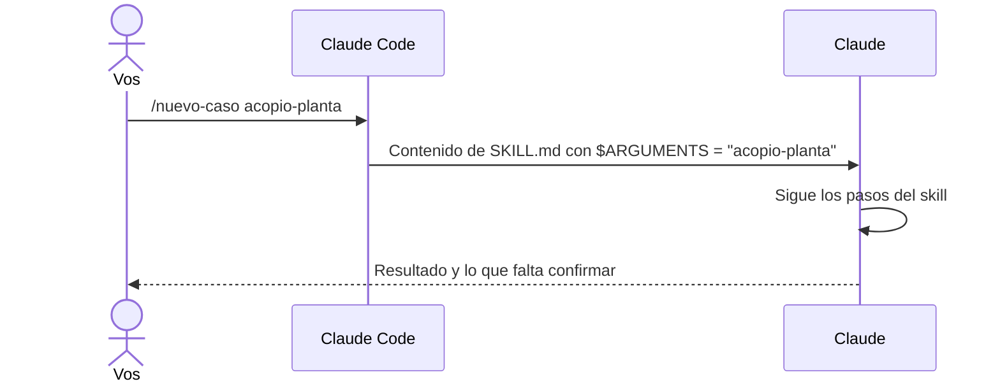
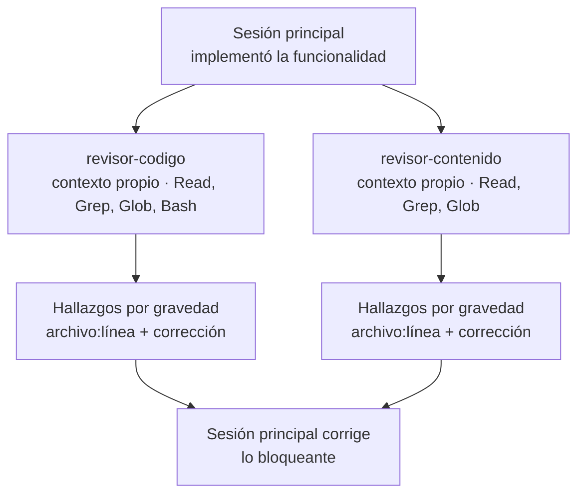
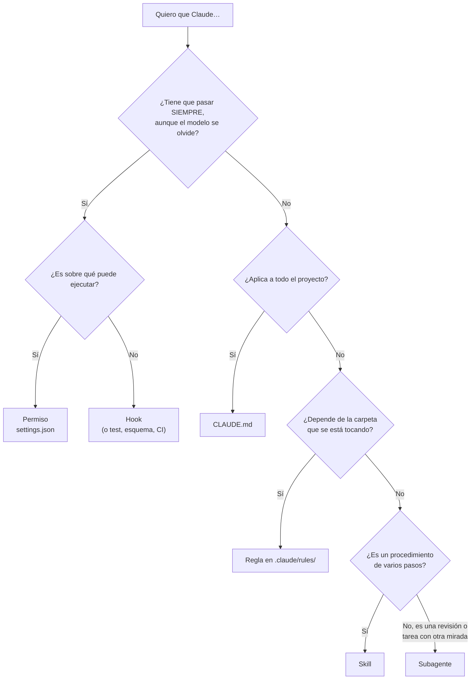

# 5 · Skills y subagentes

Hay tareas que se repiten (verificar, crear un caso, agregar experiencia) y
tareas que conviene que haga "otra persona" (revisar). Los **skills**
empaquetan procedimientos que se invocan con `/nombre`; los **subagentes**
son asistentes especializados con su propio contexto y permisos limitados.
Este capítulo explica los dos, cómo están escritos en este repo y cómo elegir
entre todas las piezas vistas hasta ahora.

## 5.1 Skills: procedimientos con nombre

Un skill es una carpeta dentro de `.claude/skills/` con un archivo
`SKILL.md`. Se ejecuta escribiendo `/<nombre>` en la sesión, y Claude también
puede usarlo por su cuenta cuando la descripción coincide con lo que pediste.

Si venís de Laravel, es como un comando de Artisan; si venís de Node, como un
script de `package.json`. La diferencia: está escrito en lenguaje natural y
lo ejecuta el agente, así que puede incluir criterio ("si el diff mezcla
temas, proponé dividirlo").

### Anatomía

```markdown
---
name: nueva-experiencia
description: Agrega o actualiza una experiencia laboral … Usar cuando Patricio quiera sumar un trabajo nuevo…
argument-hint: '[empresa o descripción libre, opcional]'
---

# Nueva experiencia

Entrada: `$ARGUMENTS` …

## 1. Entrevista

…
```

| Campo                       | Para qué                                                                                       |
| --------------------------- | ---------------------------------------------------------------------------------------------- |
| `name`                      | El comando: `/nueva-experiencia`                                                               |
| `description`               | **Lo más importante.** Claude la lee para decidir si el skill aplica: qué hace y cuándo usarlo |
| `argument-hint`             | Ayuda que aparece al escribir el comando                                                       |
| `disable-model-invocation`  | Si es `true`, solo se ejecuta cuando vos lo escribís (ej. `/commit`)                           |
| `$ARGUMENTS` (en el cuerpo) | Se reemplaza por lo que escribas después del comando                                           |

### Qué pasa al invocarlo



### Los skills de este repo

| Skill                | Qué hace                                                                                                     |
| -------------------- | ------------------------------------------------------------------------------------------------------------ |
| `/spec`              | Convierte una idea en una spec (`docs/specs/`). Pregunta, define alcance y criterios. **No escribe código.** |
| `/implementar`       | Implementa una spec aprobada con TDD, `/verificar`, revisores y actualización del roadmap                    |
| `/nueva-demo`        | Lista los archivos de una demo nueva copiando el patrón de las existentes                                    |
| `/nuevo-caso`        | Crea o migra un caso de estudio en español e inglés                                                          |
| `/nueva-experiencia` | Te entrevista (o lee un borrador) y propaga la experiencia al sitio y al CV                                  |
| `/verificar`         | Formato, lint, tipos, tests, build, e2e y control de datos privados                                          |
| `/commit`            | Revisa el diff y propone un commit con formato Conventional Commits; solo si lo pedís                        |

### Cuándo crear un skill

Regla simple: **la segunda vez que escribís los mismos pasos en un pedido,
es un skill.** Plantilla mínima:

```markdown
---
name: mi-skill
description: Qué hace en una oración. Usar cuando …
---

# Título

1. Paso concreto (con rutas y comandos reales).
2. …

Al terminar: cómo se verifica y qué se informa.
```

## 5.2 Subagentes: otra mirada, otro contexto

Un subagente es un asistente separado que la sesión principal puede lanzar
para una tarea. Se define en `.claude/agents/<nombre>.md` con un encabezado
que dice qué herramientas puede usar, y un cuerpo que es su "manual de
trabajo".

```markdown
---
name: revisor-codigo
description: Revisa el diff actual contra las convenciones técnicas… Usar después de implementar…
tools: Read, Grep, Glob, Bash
---

Sos un tech lead que revisa un pull request de este portfolio. Solo leés…
```

### Por qué usar subagentes



1. **Sin sesgo de autor.** Quien escribió el código tiende a ver lo que quiso
   hacer, no lo que hizo. El revisor arranca de cero con una sola tarea:
   encontrar problemas.
2. **Mínimo privilegio.** Los revisores no pueden editar archivos. Reportan;
   la sesión principal (o vos) decide qué se corrige.
3. **Contexto limpio.** Todo lo que el revisor lee queda en su contexto, no
   en el de la sesión principal. Solo vuelve el informe.
4. **En paralelo.** Los dos revisores pueden trabajar a la vez.

### Los subagentes de este repo

| Agente              | Revisa                                                                                        |
| ------------------- | --------------------------------------------------------------------------------------------- |
| `revisor-codigo`    | Que cumpla la spec, que haya tests, separación lógica/UI, tipos, a11y, i18n, CSP, simplicidad |
| `revisor-contenido` | Privacidad, exactitud contra la fuente, atribución individual/equipo, tono, paridad ES/EN     |

Se usan pidiéndolo ("pedile una revisión a `revisor-codigo`"), mencionándolo
con `@` (`@agent-revisor-contenido revisá src/i18n/en.ts`) o desde los skills
que los incluyen (`/implementar`, `/nuevo-caso`, `/nueva-experiencia`).

Para ver cuáles hay, mirá la carpeta: `ls .claude/agents/` (los del proyecto)
y `~/.claude/agents/` (los tuyos, para todos los proyectos). No hay un comando
que los liste: el asistente `/agents` de versiones anteriores ya no existe, y
`/list-agents` muestra solo los agentes y sesiones que están corriendo en ese
momento, no los definidos. Para crear o cambiar uno, editá el archivo o
pedíselo a Claude.

## 5.3 ¿Qué pieza uso para qué?

Ya viste cinco formas de "decirle algo" al agente. Este árbol ayuda a elegir:



| Pieza     | Se activa                       | Ejemplo en este repo                   |
| --------- | ------------------------------- | -------------------------------------- |
| CLAUDE.md | Siempre                         | "No inventes datos"                    |
| Regla     | Al tocar ciertas rutas          | "La isla no calcula reglas de negocio" |
| Skill     | Con `/nombre` o por descripción | `/nueva-experiencia`                   |
| Subagente | Cuando se lo delega             | `revisor-contenido`                    |
| Permiso   | En cada acción                  | `git push` prohibido                   |
| Hook      | En cada evento                  | Prettier después de editar             |

## 5.4 Práctica guiada

1. Leé [`.claude/skills/verificar/SKILL.md`](../../.claude/skills/verificar/SKILL.md)
   y ejecutá `/verificar`. Compará los pasos del archivo con lo que hace Claude.
2. Pedí: _"Pedile a `revisor-contenido` que revise `src/i18n/en.ts`"_. Mirá el
   formato del informe.
3. Ejercicio: escribí (o pedile a Claude que escriba con vos) un skill
   `/regenerar` que corra `npm run og` y `npm run cv` y te diga qué archivos
   cambiaron.

## Resumen

- Skill = procedimiento reutilizable en `.claude/skills/<nombre>/SKILL.md`; la
  `description` decide cuándo se usa.
- Subagente = asistente con contexto propio y herramientas limitadas; ideal
  para revisar.
- Cada pieza tiene su lugar: usá el árbol de 5.3 para decidir.

Anterior: [4 · Permisos y hooks](04-permisos-y-hooks.md) ·
Siguiente: [6 · Specs, ADR y fuente de verdad](06-specs-adr-y-fuente-de-verdad.md)
