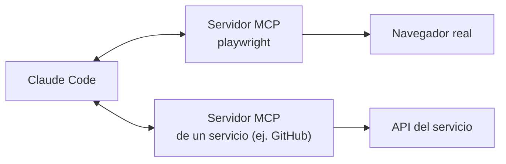
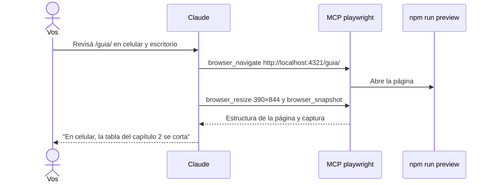
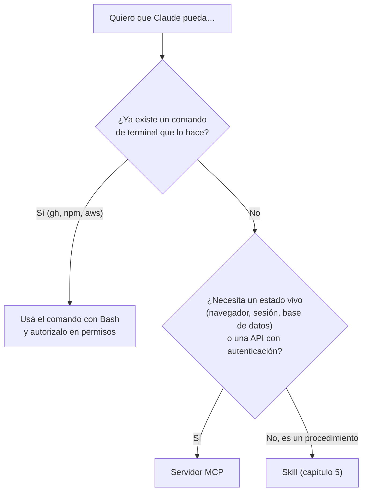

# 6 · MCP: conectar herramientas

Las skills le enseñan procedimientos al agente y los subagentes le dan otra
mirada. **MCP** le da herramientas nuevas: un navegador, una base de datos o
la API de un servicio. Este capítulo explica qué es un servidor MCP, cómo se
agrega a un proyecto, cómo usa este repo el de Playwright para mirar sus
páginas y qué cuidar en seguridad.

> **Aplicación:** En parte — el repo usa el servidor de Playwright (`.mcp.json`); el diseño de herramientas MCP propias (6.6) es teórico.

## 6.1 Qué es MCP

**MCP** (_Model Context Protocol_) es un estándar abierto para conectar un
agente con herramientas externas. Un **servidor MCP** es un programa que
publica herramientas con nombre, descripción y parámetros; Claude Code se
conecta, las ve y las usa como usa `Read` o `Bash`
([documentación](https://code.claude.com/docs/en/mcp)).

Si venís de backend: es como una API que, en lugar de documentarse para
personas, se describe para que un modelo la pueda usar sola.



Cada herramienta aparece con un nombre de la forma
`mcp__<servidor>__<herramienta>`, por ejemplo
`mcp__playwright__browser_navigate`. Ese nombre es el que se usa en los
permisos (capítulo 4).

## 6.2 Alcances: quién ve cada servidor

| Alcance           | Dónde se guarda              | Quién lo usa                                       |
| ----------------- | ---------------------------- | -------------------------------------------------- |
| Local (el normal) | `~/.claude.json`             | Solo vos, en este proyecto                         |
| Proyecto          | `.mcp.json` en la raíz (git) | Cualquiera que clone el repo, después de aprobarlo |
| Usuario           | `~/.claude.json`             | Solo vos, en todos tus proyectos                   |

Se agregan desde la terminal:

```bash
# Local: solo para vos
claude mcp add playwright -- npx @playwright/mcp@latest

# Proyecto: se escribe en .mcp.json y se versiona
claude mcp add --scope project playwright -- npx @playwright/mcp@0.0.85

# Ver los servidores y si están conectados
claude mcp list
```

Dentro de una sesión, `/mcp` muestra los servidores, su estado y sus
herramientas.

## 6.3 El servidor de este repo: Playwright

Los e2e comprueban que las páginas funcionen y sean accesibles, pero no si
algo **se ve** roto. Para eso el repo tiene un `.mcp.json` con el servidor
MCP de Playwright, que le da a Claude un navegador real
([servidor](https://github.com/microsoft/playwright-mcp)):

```json
{
  "mcpServers": {
    "playwright": {
      "type": "stdio",
      "command": "npx",
      "args": ["@playwright/mcp@0.0.85"]
    }
  }
}
```

La versión está fija (`0.0.85`) para que una actualización no cambie los
nombres de las herramientas que autorizan los permisos (6.4); se sube a mano
([ADR 0008](../adr/0008-mcp-y-claude-en-ci.md)).



Cómo se usa:

1. La primera vez que abrís `claude` en el repo, Claude Code te pregunta si
   aprobás el servidor del proyecto. Un `.mcp.json` puede venir de cualquiera
   que clone o mande una PR, por eso no se activa solo.
2. Con `npm run preview` corriendo, pedís: _"Usá el MCP de Playwright para
   revisar `/guia/` en 390 px y en 1280 px y decime qué se ve roto"_.
3. `/verificar` lo incluye como paso opcional cuando una tarea cambió el
   aspecto de una página.

No reemplaza a los e2e: la revisión visual la hace un modelo y puede pasar
algo por alto. Los tests son los que fallan en CI.

## 6.4 Permisos y seguridad

Un servidor MCP es **código de terceros que corre en tu máquina** y le da
nuevas capacidades al agente. Antes de agregar uno:

- **Origen:** que sea oficial o de alguien de confianza. Playwright MCP es de
  Microsoft.
- **Permisos por herramienta:** en este repo, las herramientas de navegar,
  mirar y hacer clic están en `allow`. Las dos que ejecutan código arbitrario
  (`browser_evaluate` y `browser_run_code_unsafe`) están en `ask`: Claude
  tiene que pedirte permiso cada vez.
- **Contenido externo:** lo que el servidor trae de afuera (una página web, un
  issue) puede contener instrucciones escondidas. Se trata como datos, no
  como órdenes (capítulo 18).
- **Contexto:** cada servidor suma sus herramientas al contexto. Claude Code,
  por defecto, carga solo los nombres hasta que hace falta usar una, pero conviene
  desactivar con `/mcp` los servidores que no usás.

## 6.5 Cuándo conviene un MCP (y cuándo no)



Un comando de terminal ocupa menos contexto que un servidor MCP, porque no
publica una lista de herramientas. Por eso este repo usa `gh`, `git` y `npm`
directamente, y MCP solo para el navegador, que no tiene un buen equivalente
de terminal para "mirar" una página.

## 6.6 Diseñar herramientas para un agente

> **Para la certificación.** Este repo no tiene servidores MCP propios. Esta
> sección explica cómo se diseña uno, un tema que pide la certificación
> Claude Certified Architect:
> Foundations.

Si escribís tu propio servidor MCP, el modelo decide **solo con la
descripción** cuándo y cómo usar cada herramienta. Las reglas que más
diferencia hacen:

| Regla                                                               | Mal                       | Bien                                                                                                    |
| ------------------------------------------------------------------- | ------------------------- | ------------------------------------------------------------------------------------------------------- |
| La descripción dice qué hace, cuándo usarla y qué no hace           | "Busca clientes"          | "Busca clientes por email exacto. Para búsquedas por nombre usá `buscar_por_nombre`. Devuelve hasta 10" |
| Herramientas parecidas se distinguen por el nombre y la descripción | `buscar` y `buscar2`      | `buscar_por_email` y `buscar_por_nombre`                                                                |
| Los parámetros tienen tipos y ejemplos                              | `fecha: string`           | `fecha: string (AAAA-MM-DD, ej. 2026-03-01)`                                                            |
| Los errores dicen qué pasó y si sirve reintentar                    | `"Error"`                 | `{ categoria: "validacion", reintentable: false, mensaje: "El email no tiene @" }`                      |
| Pocas herramientas, con un propósito claro                          | 40 herramientas genéricas | Las 5 que el agente realmente necesita                                                                  |

El error estructurado es lo que le permite al agente decidir solo: un error
de validación se corrige y se reintenta distinto; uno temporal (un _timeout_)
se reintenta igual; uno de permisos se le informa a la persona.

## 6.7 Práctica guiada

1. Abrí `claude` en el repo, aprobá el servidor `playwright` y corré
   `claude mcp list` en otra terminal: tiene que figurar como conectado.
2. Con `npm run preview` corriendo, pedí: _"Usá Playwright para abrir
   `/guia/mcp/` en 390 px y decime si la tabla de 6.6 se puede leer"_.
3. Ejercicio: escribí la descripción de una herramienta `crear_issue` para un
   servidor MCP propio, con sus parámetros y los errores posibles.

## Resumen

- Un servidor MCP le da herramientas nuevas al agente; se agrega con
  `claude mcp add` y, a nivel proyecto, queda en `.mcp.json`.
- Los servidores del proyecto se aprueban la primera vez; sus herramientas se
  autorizan una por una en los permisos.
- Este repo usa Playwright para la revisión visual; los e2e siguen siendo la
  red de seguridad.
- Si existe un comando de terminal, suele convenir más que un MCP.

Anterior: [5 · Skills y subagentes](05-skills-y-subagentes.md) ·
Siguiente: [7 · Orquestación de agentes](07-orquestacion-de-agentes.md)
