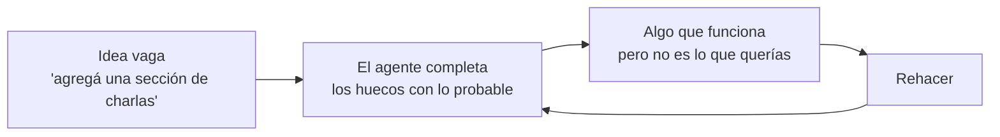
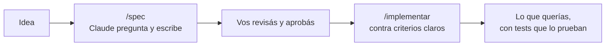
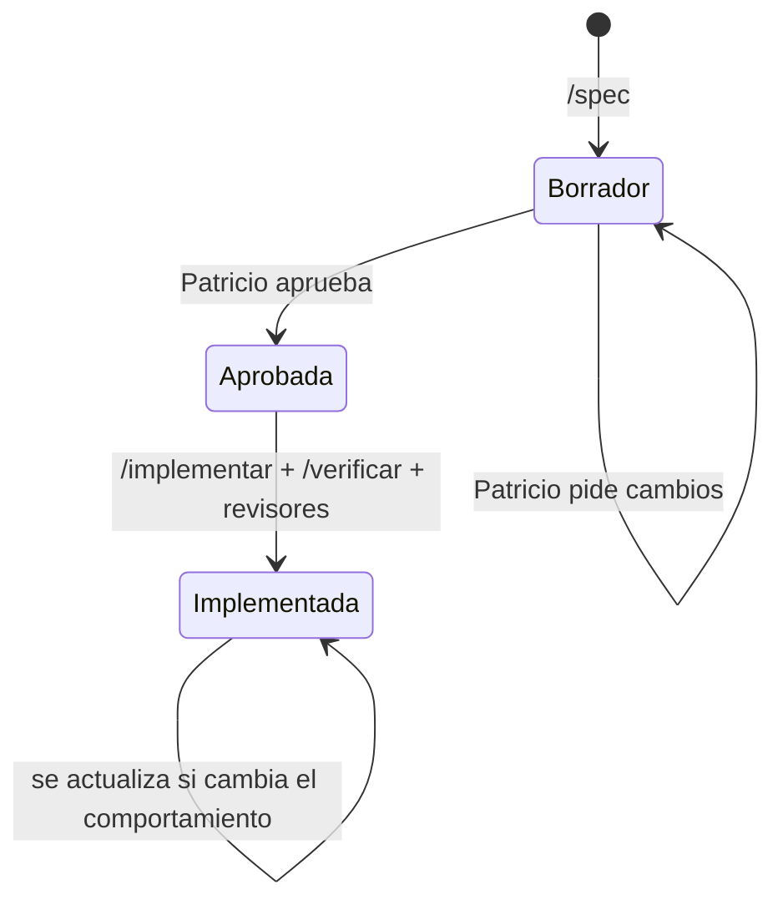
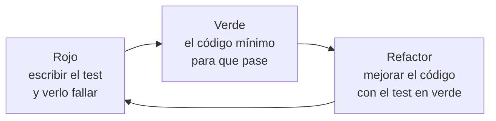
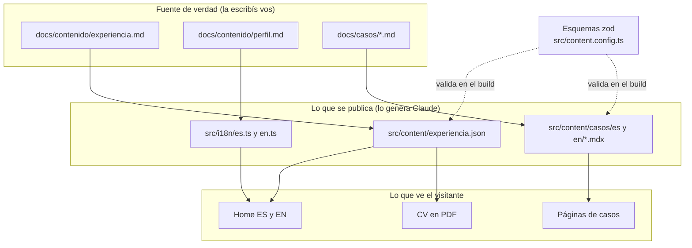

# 6 · Specs, ADR y fuente de verdad

Las piezas anteriores le dicen al agente **cómo** trabajar. Este capítulo
trata de **qué** construir y **con qué datos**: las _specs_ (acordar el
alcance antes de programar), los _ADR_ (registrar por qué se decidió algo) y
la _fuente de verdad_ (el único lugar donde un dato es correcto).

## 6.1 Por qué escribir una spec antes de programar

Con un agente, escribir código es barato y rápido. Lo caro es **construir lo
que no era**. Sin una spec pasa esto:

Con una spec, las preguntas se resuelven **antes**, cuando cambiar algo es
editar un párrafo:

Si trabajaste con Jira o similar, una spec es un **ticket bien escrito**: una
historia de usuario con criterios de aceptación y lo que queda fuera.

## 6.2 Ciclo de vida de una spec

El skill `/implementar` **se niega** a empezar si la spec no está
`Aprobada`. Es intencional: la aprobación es tu punto de control.

## 6.3 Anatomía de una spec

Plantilla: [`docs/specs/_plantilla.md`](../specs/_plantilla.md). Ejemplo
real: [`003-demo-contingencias.md`](../specs/003-demo-contingencias.md).

| Sección                     | Qué va                                           | Por qué importa con un agente                 |
| --------------------------- | ------------------------------------------------ | --------------------------------------------- |
| Problema                    | Qué falta y a quién afecta                       | Que entienda el motivo y no solo la tarea     |
| Objetivo                    | Qué puede hacer el visitante al terminar         | Define "terminado" desde el usuario           |
| Alcance                     | Lista concreta de lo que se construye            | Evita interpretaciones                        |
| **Fuera de alcance**        | Lo que explícitamente no se hace                 | Frena la tendencia a agregar cosas no pedidas |
| Diseño                      | Módulos, UI, textos, rutas, rendimiento          | Encaja con la arquitectura existente          |
| **Criterios de aceptación** | Tabla: criterio verificable → test que lo prueba | Convierte "terminado" en algo comprobable     |
| Preguntas abiertas          | Datos que faltan (`TODO(contenido)`)             | Lo que no se sabe queda visible, no inventado |

Un criterio de aceptación de la spec 003:

| #   | Criterio                                                | Test                                        |
| --- | ------------------------------------------------------- | ------------------------------------------- |
| 4   | El mantenimiento total forzado gana sobre todo lo demás | unitario + `e2e/demo-contingencias.spec.ts` |

"Gana sobre todo lo demás" se puede comprobar con un test. "Que el
mantenimiento funcione bien" no.

## 6.4 De criterio a test: TDD

`/implementar` trabaja criterio por criterio con **TDD** (_test-driven
development_):

¿Por qué importa con un agente? Porque el test que falla primero demuestra
que el test realmente prueba algo. Y porque, al final, "terminado" no es la
opinión del agente: es una lista de tests en verde.

## 6.5 ADR: el porqué de las decisiones

Un ADR (_Architecture Decision Record_) es un documento corto que registra
**una** decisión técnica: contexto, qué se eligió, **qué alternativas se
descartaron y por qué**, y consecuencias. Están en
[`docs/adr/`](../adr/).

Sin ADR, cada tanto alguien (o el agente) propone volver a una opción ya
descartada. Ejemplo real:

> ¿Por qué el mapa de beneficios no usa Google Maps?
> → [ADR 0004](../adr/0004-mapa-en-svg.md): la API key quedaría expuesta en un
> repositorio público y agregaría un tercero a la política de seguridad.

| ADR                                                       | Decisión                                       |
| --------------------------------------------------------- | ---------------------------------------------- |
| [0001](../adr/0001-astro-con-islas-react.md)              | Astro estático con islas React                 |
| [0002](../adr/0002-menu-y-tema-sin-react.md)              | Menú y tema sin React (presupuesto de la home) |
| [0003](../adr/0003-highs-en-web-worker.md)                | Solver HiGHS en un Web Worker                  |
| [0004](../adr/0004-mapa-en-svg.md)                        | Mapa en SVG                                    |
| [0005](../adr/0005-desarrollo-guiado-por-specs-con-ia.md) | Desarrollo guiado por specs con Claude Code    |

Cuándo escribir uno: cuando hubo **alternativas reales** y elegir una tiene
consecuencias. Un ADR no se edita para cambiar de opinión: se escribe uno
nuevo que lo reemplaza, y así queda la historia.

## 6.6 Fuente de verdad: de dónde salen los datos

El agente completa huecos con lo probable (capítulo 1). En un portfolio eso es
grave: una fecha o una métrica inventada es un problema en una entrevista. Por
eso cada dato tiene **un** lugar donde es correcto por definición, y todo lo
demás deriva de ahí.

- Si un dato no está en la fuente, no se inventa: se marca `TODO(contenido)` y
  se pregunta.
- Las métricas se etiquetan `real` o `ilustrativa`; las ilustrativas solo
  aparecen junto a la demo que las produce.
- `docs/privado/` está fuera de git: material personal y la lista de términos
  que usan el hook de privacidad y `/verificar`.

### Los esquemas zod como contrato

`src/content.config.ts` define con zod la forma de cada experiencia y cada
caso. Si Claude (o vos) carga una fecha como `"marzo 2027"` en lugar de
`"2027-03"`, **el build falla**. Es un control determinístico (capítulo 4)
aplicado a los datos: aunque la IA se equivoque, el error no llega a
producción.

El contrato completo de la experiencia está en
[`docs/specs/005-experiencia.md`](../specs/005-experiencia.md).

## 6.7 Práctica guiada

1. Leé la spec [`003-demo-contingencias.md`](../specs/003-demo-contingencias.md)
   y abrí `src/lib/contingencias/evaluar.test.ts`: buscá el test de cada criterio.
2. En modo plan, pedí: _"/spec una sección 'Charlas y artículos' en la home"_.
   Respondé las preguntas y mirá el borrador. Si no lo vas a hacer, pedile que
   lo borre.
3. Leé el [ADR 0003](../adr/0003-highs-en-web-worker.md) y preguntate si
   podrías explicarlo en una entrevista.

## Resumen

- Spec = alcance + fuera de alcance + criterios verificables, aprobada antes de programar.
- Cada criterio se vuelve un test; TDD asegura que el test prueba algo.
- ADR = una decisión con sus alternativas descartadas.
- Cada dato tiene una fuente de verdad; zod impide que un dato mal formado llegue al sitio.

Anterior: [5 · Skills y subagentes](05-skills-y-subagentes.md) ·
Siguiente: [7 · Flujos de trabajo](07-flujos-de-trabajo.md)
