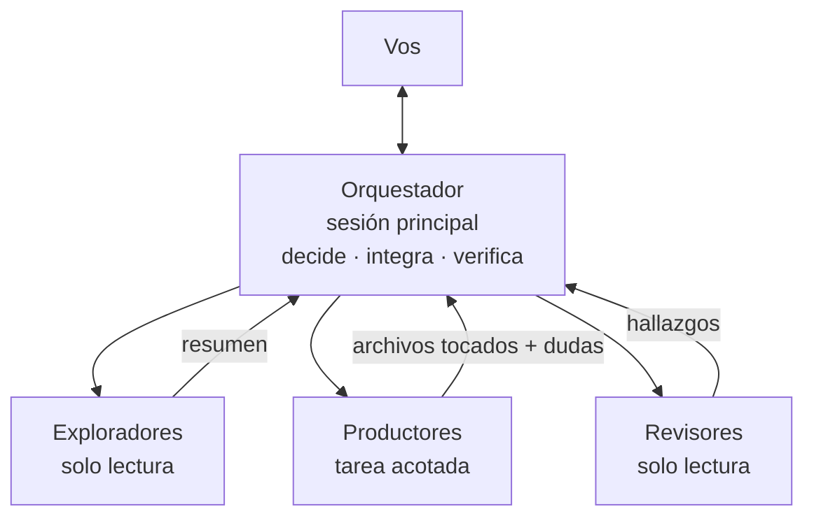
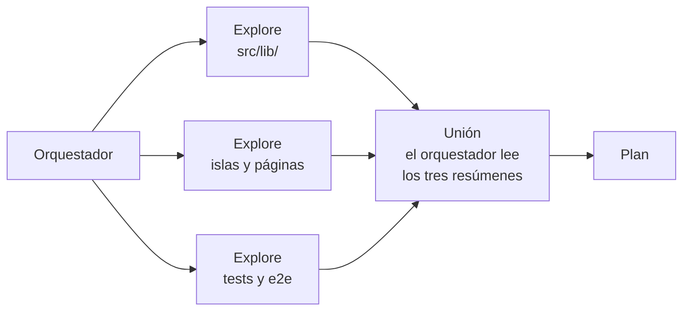
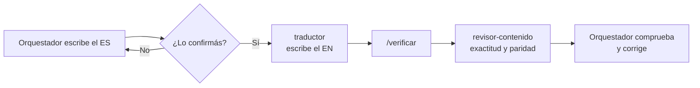
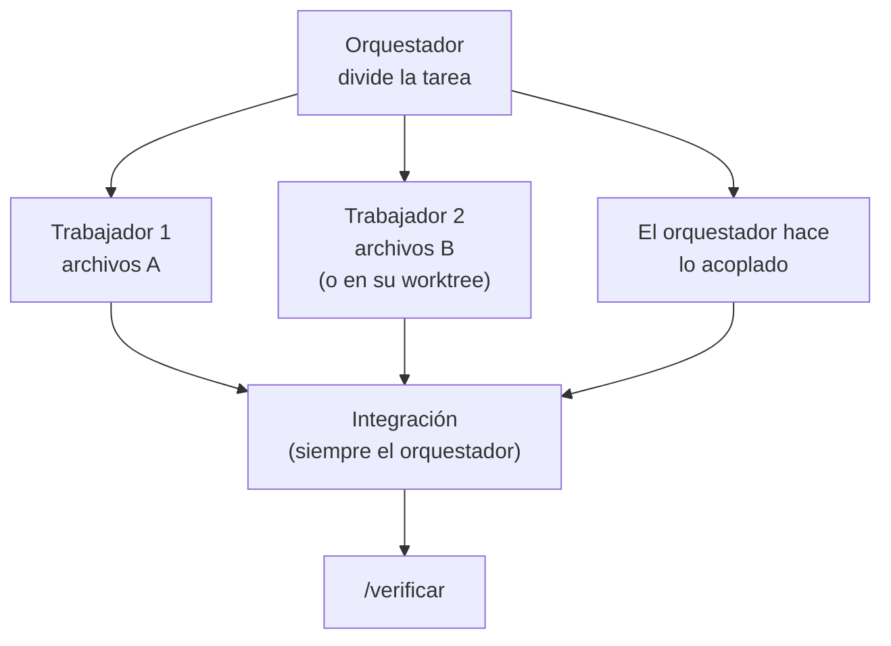
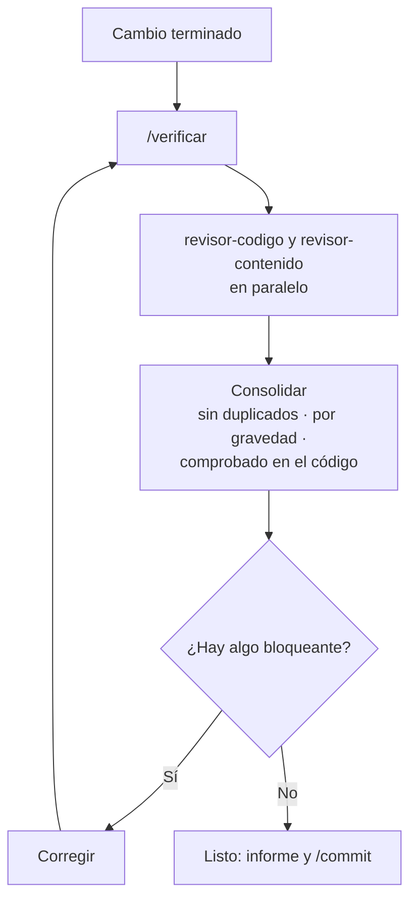
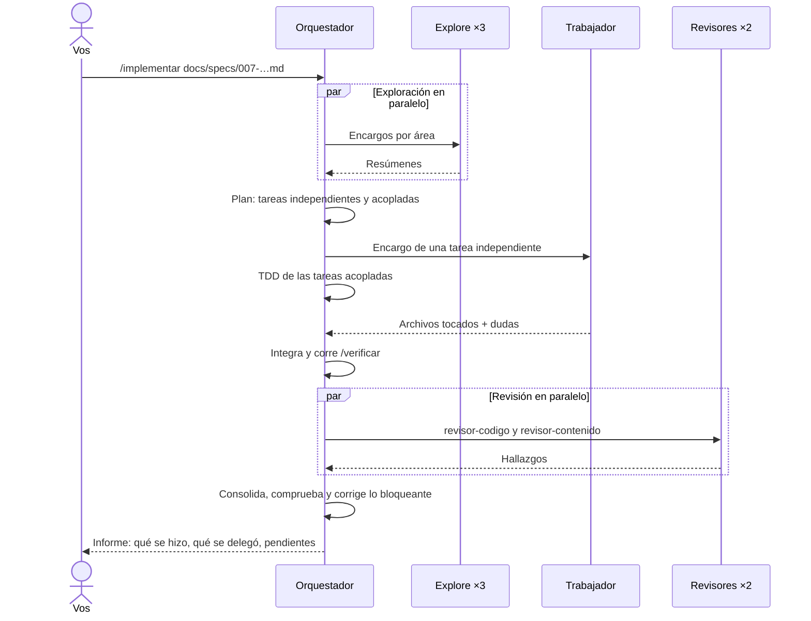
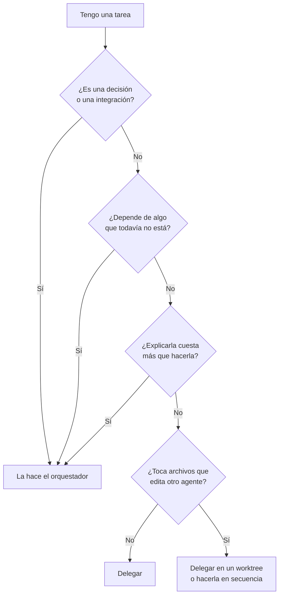

# 7 · Orquestación de agentes

Un subagente solo es una ayuda; varios bien coordinados son un equipo.
**Orquestar** es repartir una tarea entre agentes (en paralelo o en cadena) y
después juntar, comprobar e integrar lo que devuelven. Este capítulo explica
cuándo conviene, los cuatro patrones que usa este repo, cómo se escribe un
encargo para un subagente y cuándo es mejor no orquestar.

> **Aplicación:** En este repo — `/spec`, `/implementar`, `/nuevo-caso` y `/nueva-experiencia`; agent teams y `claude -p` (7.7) no se usan.

## 7.1 De un agente a un equipo

En el capítulo 5 viste un subagente: un asistente con contexto propio al que
la sesión le delega una tarea. Orquestar es usar varios a la vez con un
reparto de roles claro:

- **Orquestador:** la sesión principal, la que habla con vos. Entiende el
  pedido, arma el plan, decide qué delega, integra los resultados y verifica.
- **Trabajadores:** subagentes con una sola tarea, un contexto limpio y las
  herramientas justas. Exploran, producen algo acotado o revisan.

Si venís de backend, pensá en un _job_ que reparte trabajo entre _workers_ y
después consolida. La diferencia es que acá los workers razonan, y por eso
el encargo que les das importa tanto como el código que escribirías.



## 7.2 Por qué orquestar

1. **Contexto limpio.** Lo que lee un subagente queda en su contexto; a la
   sesión principal solo vuelve el resumen. Así la sesión que decide no se
   llena de archivos que solo servían para orientarse.
2. **Paralelismo.** Tres exploraciones independientes tardan lo que la más
   lenta, no la suma de las tres.
3. **Especialización.** Cada agente tiene su "manual" (el cuerpo del
   `.md`) y un solo objetivo. Un traductor no opina de arquitectura.
4. **Mínimo privilegio.** Cada uno recibe solo las herramientas que
   necesita: los revisores no editan y el traductor no ejecuta comandos.
5. **Sin sesgo de autor.** Quien produce no es quien controla.

El costo: cada subagente arranca **sin tu conversación**, así que gasta
tokens en entender la tarea y depende de que el encargo sea bueno. Por eso
no todo se delega (7.6).

## 7.3 Los cuatro patrones

### Paralelo y unión

Varias tareas independientes al mismo tiempo; el orquestador espera todas y
une los resultados. En este repo se usa para **explorar** antes de planificar
(`/spec`, `/implementar`) y para **revisar** al final.



Para que corran en paralelo, pedí que los lance **en el mismo mensaje**
([documentación](https://code.claude.com/docs/en/sub-agents)). Si no, lo
habitual es que espere a cada uno antes de lanzar el siguiente.

### Cadena: productor → verificador

Un agente produce y otro, distinto, controla. La salida de uno es la entrada
del siguiente, así que van en secuencia. En este repo, el inglés de un caso o
de una experiencia lo escribe `traductor` y lo controla `revisor-contenido`.



### Orquestador y trabajadores con archivos propios

El orquestador divide una tarea grande en partes que **no tocan los mismos
archivos** y delega algunas. Si dos trabajadores pudieran editar lo mismo, se
los aísla en un **worktree**: una copia de trabajo de git en otra carpeta,
con su propia rama, donde los cambios no chocan. Claude Code lo permite con
`isolation: worktree` en el frontmatter del agente
([documentación](https://code.claude.com/docs/en/sub-agents)), o pidiéndoselo
al lanzarlo.



Un detalle que se olvida fácil: el worktree arranca desde la rama base, **no
desde tus cambios sin commitear**
([documentación](https://code.claude.com/docs/en/worktrees)). Si el trabajador necesita lo que acabás de
escribir, o lo commiteás antes o no usás worktree.

### Bucle de revisión

Revisar, corregir lo bloqueante y volver a revisar **solo** lo corregido,
hasta que no quede nada bloqueante. Un consejo para que el bucle tenga
salida: si una segunda vuelta encuentra lo mismo, revisá el encargo o la
regla antes de seguir corrigiendo código.



## 7.4 Cómo se escribe un encargo

El subagente no vio tu conversación, no sabe qué decidiste ni por qué. Todo
lo que necesita tiene que estar en el encargo. Un buen encargo responde cinco
preguntas:

| Pregunta               | Ejemplo                                                                 |
| ---------------------- | ----------------------------------------------------------------------- |
| ¿Qué tiene que lograr? | "Escribí la versión en inglés del caso `acopio-planta`"                 |
| ¿Qué tiene que leer?   | "Origen: `src/content/casos/es/…`; modelo: otro caso en `en/`"          |
| ¿Qué no puede tocar?   | "Solo editás el archivo EN; el slug, `tipo` e imports no se traducen"   |
| ¿Cuándo está listo?    | "Mismo frontmatter y secciones que el ES, sin datos agregados"          |
| ¿Qué devuelve?         | "Archivos tocados y dudas con `archivo:línea`; no repitas el contenido" |

Plantilla (la misma que usa `/implementar`):

```text
Objetivo: <qué tiene que quedar hecho, en una oración>
Contexto: spec <ruta> (criterios N y M); archivos a leer: <rutas>
Límites: tocá solo <rutas>; no cambies <…>; no ejecutes <…>
Listo cuando: <condición verificable>
Respuesta: archivos tocados + dudas con archivo:línea (sin repetir el código)
```

Pedir un **resumen** y no el contenido es lo que hace que el contexto del
orquestador quede limpio.

## 7.5 La orquestación en este repo

| Skill                | Qué orquesta                                                                                         |
| -------------------- | ---------------------------------------------------------------------------------------------------- |
| `/spec`              | Hasta 3 `Explore` en paralelo (specs y ADR, código reutilizable, tests) antes de hacer las preguntas |
| `/implementar`       | Explora en paralelo, delega lo independiente, verifica, revisa en paralelo y consolida               |
| `/nuevo-caso`        | Cadena: el ES lo escribe la sesión y vos lo confirmás → `traductor` (EN) → `revisor-contenido`       |
| `/nueva-experiencia` | La misma cadena para la línea de tiempo y los textos de `src/i18n/`                                  |

`Explore` es un subagente **integrado** de Claude Code (no está en
`.claude/agents/`): de solo lectura y pensado para buscar en el código
([documentación](https://code.claude.com/docs/en/sub-agents)). Los
otros tres son del repo: `revisor-codigo`, `revisor-contenido` y
[`traductor`](../../.claude/agents/traductor.md).

Así queda `/implementar` de punta a punta:



El patrón y sus alternativas están en el
[ADR 0007](../adr/0007-orquestacion-de-agentes.md); las instrucciones exactas,
en [`.claude/skills/implementar/SKILL.md`](../../.claude/skills/implementar/SKILL.md).

## 7.6 Cuándo no orquestar

Orquestar no es gratis: cada subagente lee de nuevo lo que necesita, y un
encargo ambiguo produce trabajo que hay que rehacer.



Nunca se delegan:

- **Las decisiones:** qué se construye, qué hallazgo se corrige y qué se le
  pregunta a la persona.
- **La integración y `/verificar`:** quien junta las partes es quien
  responde por el resultado.
- **La confianza en un informe:** lo que dice un subagente se comprueba en el
  código antes de actuar. Un informe es un dato, no una orden.

## 7.7 Más allá: otras formas de repartir trabajo

Este repo usa subagentes dentro de una sesión. Claude Code tiene otras
herramientas que conviene conocer; ninguna hace falta para el portfolio:

- **Subagentes en segundo plano:** el orquestador sigue trabajando y el
  resultado le llega cuando el subagente termina
  ([documentación](https://code.claude.com/docs/en/sub-agents)).
- **Skills que corren en un subagente:** con `context: fork` y
  `agent: Explore` (u otro) en el frontmatter, el skill entero se ejecuta en
  un contexto aislado ([documentación](https://code.claude.com/docs/en/skills)).
- **Modo headless (`claude -p`):** Claude Code desde un script o el CI, sin
  conversación. Sirve para tareas en lote, y es lo que usa por dentro la
  acción de GitHub del capítulo 16
  ([documentación](https://code.claude.com/docs/en/headless)).
- **Agent teams:** varias sesiones coordinadas que se mandan mensajes y
  comparten una lista de tareas. Son **experimentales**, vienen apagados y
  tienen limitaciones conocidas
  ([documentación](https://code.claude.com/docs/en/agent-teams)).

## 7.8 Práctica guiada

1. Pedí, en un solo mensaje: _"Lanzá en paralelo tres agentes `Explore`:
   uno que resuma `src/lib/`, otro las páginas de `src/pages/` y otro los
   tests de `e2e/`. Quiero un resumen de cada uno, sin el contenido de los
   archivos."_ Fijate que arranquen a la vez y que en tu sesión solo entren
   los resúmenes.
2. Leé [`.claude/agents/traductor.md`](../../.claude/agents/traductor.md) y
   compará su `tools:` con el de los revisores
   ([campos del frontmatter](https://code.claude.com/docs/en/sub-agents)). ¿Por qué tiene `Edit` y no
   `Bash`?
3. Ejercicio: escribí un encargo con la plantilla de 7.4 para que un
   subagente agregue una pregunta frecuente a la página de contacto. ¿Qué
   archivos no puede tocar? ¿Cuándo está listo?

## Resumen

- Orquestar = la sesión principal reparte, los subagentes ejecutan y el
  orquestador integra y verifica.
- Cuatro patrones: paralelo y unión, cadena productor → verificador,
  trabajadores con archivos propios (o worktree) y bucle de revisión.
- Un encargo es autocontenido: objetivo, contexto, límites, criterio de
  "listo" y formato de respuesta.
- No se delegan las decisiones, la integración ni la verificación.

Anterior: [6 · MCP: conectar herramientas](06-mcp.md) ·
Siguiente: [8 · Specs, ADR y fuente de verdad](08-specs-adr-y-fuente-de-verdad.md)
