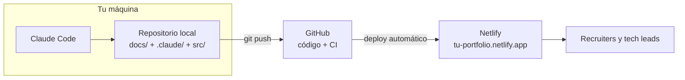
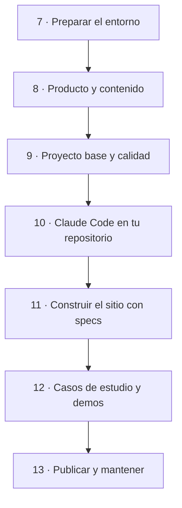
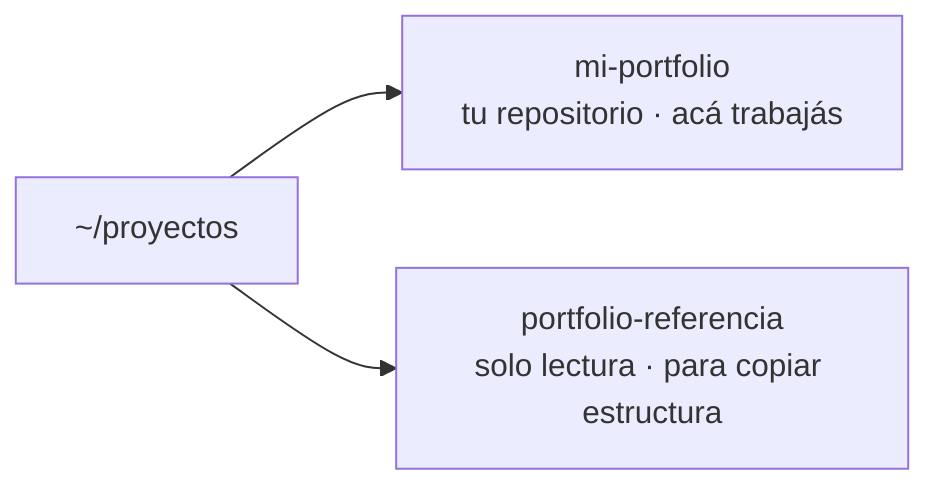

# 7 · Tutorial: preparar el entorno

Empieza el paso a paso. En este capítulo creás las cuentas, instalás las
herramientas y dejás listo un repositorio vacío con Claude Code funcionando.
Al final vas a tener tu máquina conectada a GitHub y una primera sesión
abierta. No hace falta experiencia previa con agentes: los capítulos 1 a 6
explican el porqué de cada cosa que vas a hacer acá.

## 7.1 Qué vas a construir

Al terminar el tutorial vas a tener un portfolio publicado en internet, con
la misma arquitectura que este, y un repositorio preparado para seguir
mejorándolo con IA:



## 7.2 El recorrido del tutorial



El orden importa: primero se define **qué** querés mostrar (capítulo 8),
después la base técnica y los controles (9 y 10), y recién entonces se
construye el sitio (11 y 12). Es el orden que recomendamos: este
portfolio sumó la configuración de Claude Code más tarde, y por eso la guía
la adelanta (así se aprovecha desde el primer día).

> **Sobre copiar este portfolio.** Podés reutilizar la estructura, la
> configuración de Claude Code y las ideas técnicas. El **contenido** (textos,
> casos, experiencia, CV) es personal: el tuyo tiene que salir de tu
> trayectoria. Un portfolio con logros ajenos se cae en la primera entrevista.

## 7.3 Cuentas

| Cuenta                             | Para qué              | Costo                                                            |
| ---------------------------------- | --------------------- | ---------------------------------------------------------------- |
| [GitHub](https://github.com)       | Guardar el código, CI | Gratis                                                           |
| [Netlify](https://www.netlify.com) | Publicar el sitio     | Gratis (plan inicial)                                            |
| [Claude](https://claude.ai)        | Usar Claude Code      | Requiere un plan pago que incluya Claude Code, o créditos de API |

Conviene crear la de Netlify **con tu cuenta de GitHub**: así después solo
elegís el repositorio y listo.

## 7.4 Herramientas

Instalá, en este orden:

1. **Node.js (versión LTS)** desde https://nodejs.org. Incluye `npm`.
2. **Git.** En Windows, [Git for Windows](https://git-scm.com/download/win):
   además de `git`, trae **Git Bash**, que Claude Code necesita en Windows.
3. **Un editor.** [VS Code](https://code.visualstudio.com) es la opción más
   común; la extensión de Claude Code se integra con él.
4. **Claude Code**, con el instalador nativo o con npm (detalle en el
   [capítulo 2](02-primeros-pasos.md)):

   ```bash
   curl -fsSL https://claude.ai/install.sh | bash   # Git Bash, macOS o Linux
   ```

Comprobá que todo responde (en Git Bash o en la terminal de tu sistema):

```bash
node -v          # la versión LTS que instalaste (este portfolio usa Node 24)
git --version
claude --version
```

Configurá tu identidad en Git, que queda en cada commit:

```bash
git config --global user.name "Tu Nombre"
git config --global user.email "tu@email.com"
```

## 7.5 El repositorio

1. En GitHub: **New repository** → nombre (por ejemplo, `portfolio`) →
   **Public** → sin README (lo crea el proyecto después) → **Create**.
2. Clonalo en tu máquina y, al lado, el de este portfolio como referencia:

```bash
cd ~/proyectos                      # o la carpeta donde guardes tus proyectos
git clone https://github.com/<tu-usuario>/portfolio.git mi-portfolio
git clone https://github.com/patricioprp/portfolio.git portfolio-referencia
```



> No pongas tu proyecto **dentro** de otra carpeta que tenga su propio
> `CLAUDE.md`: Claude Code cargaría las dos instrucciones (capítulo 3).

## 7.6 Primera sesión

```bash
cd mi-portfolio
claude --add-dir ../portfolio-referencia
```

La opción `--add-dir` le da a Claude acceso a la carpeta de referencia
(las ediciones siguen sujetas a los permisos), así puede leer, copiar y
adaptar archivos cuando se lo pidas. La
primera vez te pide iniciar sesión.

Probá con un pedido inocuo, en modo plan (Shift+Tab):

> _"Mirá `../portfolio-referencia` y explicame en 10 líneas cómo está
> organizado: qué hay en `docs/`, en `.claude/` y en `src/`."_

## Cómo sabés que salió bien

- [ ] `node -v`, `git --version` y `claude --version` responden.
- [ ] Tenés `mi-portfolio` (vacío, conectado a tu GitHub) y `portfolio-referencia`.
- [ ] Claude te describió la estructura del repositorio de referencia.

## Resumen

- Tres cuentas (GitHub, Netlify, Claude) y cuatro herramientas (Node, Git, editor, Claude Code).
- Tu repositorio y el de referencia como carpetas hermanas.
- `claude --add-dir ../portfolio-referencia` para que Claude pueda leer la referencia.

Anterior: [6 · Specs, ADR y fuente de verdad](06-specs-adr-y-fuente-de-verdad.md) ·
Siguiente: [8 · Tutorial: producto y contenido](08-producto-y-contenido.md)
