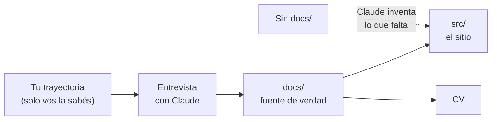

# 8 · Tutorial: producto y contenido

Antes de escribir una línea de código vas a dejar escrito **para qué** es tu
portfolio y **qué** vas a contar. Esto se hace primero porque es lo único
que la IA no puede saber por su cuenta: si falta, la completa con lo
probable (capítulo 1). En este capítulo Claude te entrevista y vos le dictás
tu trayectoria.

## 8.1 Por qué empezar por acá



Lo que escribas en `docs/` va a ser la **fuente de verdad** (capítulo 6):
el sitio se genera a partir de ahí, y una regla en `CLAUDE.md` le prohíbe a
Claude inventar lo que no esté.

## 8.2 El documento de producto

`docs/PRODUCTO.md` responde: ¿qué querés lograr?, ¿quién lo va a leer?, ¿qué
tiene que ver en los primeros 30 segundos? Abrí una sesión en `mi-portfolio`
y pedí:

> _"Quiero armar mi portfolio profesional. Haceme preguntas (todas juntas,
> con ejemplos de respuesta) para escribir `docs/PRODUCTO.md` con: objetivo,
> públicos, propuesta de valor, estructura de la home y de las páginas, y
> métricas de calidad. Usá `../portfolio-referencia/docs/PRODUCTO.md` como
> ejemplo de formato, pero el contenido tiene que salir de mis respuestas.
> No escribas código."_

Decisiones que te va a preguntar y conviene pensar:

| Pregunta                                      | Ejemplo en este portfolio                                         |
| --------------------------------------------- | ----------------------------------------------------------------- |
| ¿Buscás empleo, clientes freelance o las dos? | Solo empleo estable: sin sección de servicios                     |
| ¿Quién lo lee primero?                        | Recruiters (seniority, stack, CV) y tech leads (criterio técnico) |
| ¿Qué te diferencia?                           | Casos con impacto medible y demos que se pueden usar              |
| ¿En qué idiomas?                              | Español e inglés                                                  |
| ¿Qué presupuesto de rendimiento?              | Home con 50 KB o menos de JavaScript (comprimido)                 |

## 8.3 Tu perfil y tu experiencia

Creá la fuente de verdad del contenido en `docs/contenido/`:

> _"Entrevistame para escribir `docs/contenido/perfil.md` (datos de contacto
> publicables, formación, idiomas, stack) y `docs/contenido/experiencia.md`
> (cada trabajo en orden cronológico inverso: empresa, rol, período, 2 a 5
> logros y stack). Para cada logro preguntame qué problema había, qué hice yo
> y qué cambió. Usá como formato
> `../portfolio-referencia/docs/contenido/_plantilla-experiencia.md`."_

Tres reglas que valen oro en una entrevista:

1. **Cada logro: problema → qué hiciste → qué cambió.** "Desarrollé
   formularios" no dice nada; "las planillas pasaron de requerir un deploy a
   configurarse sin programar" sí.
2. **Separá lo tuyo de lo del equipo.** "Participé en…", "desarrollé…".
3. **Métricas honestas.** Etiquetalas `real` (medida) o `ilustrativa`
   (estimada o de una demo). Las ilustrativas nunca como logro profesional.

## 8.4 Los casos de estudio (borrador)

Elegí **2 o 3 problemas** en los que hayas tenido impacto. Para cada uno, un
archivo en `docs/casos/<slug>.md`:

> _"Para el caso `<slug>`, entrevistame y escribí `docs/casos/<slug>.md` con:
> contexto, el reto técnico, qué hice (por etapas), resultados con métricas
> etiquetadas real/ilustrativa, stack y qué se puede contar y qué no. Mirá
> `../portfolio-referencia/docs/casos/` como ejemplo de formato."_

Si el trabajo fue para un cliente, **anonimizalo** ("empresa de salud de alcance
nacional", "empresa de logística regional") y no publiques nombres de
sistemas internos.

## 8.5 Lo que nunca se publica

El repositorio va a ser público. Antes del primer commit:

1. Creá `docs/privado/` para notas personales (preparación de entrevistas,
   referencias laborales, datos que no van al sitio).
2. Creá `docs/privado/terminos-sensibles.txt` con, una por línea, las
   palabras que **nunca** pueden aparecer en el repositorio (nombres de
   clientes, de sistemas internos, tu fecha de nacimiento…). Un hook la va a
   usar para bloquear cualquier filtración (capítulo 10).
3. Creá `.gitignore` con, al menos:

```text
node_modules/
dist/
.astro/
.env
.env.*
docs/privado/
CLAUDE.local.md
```

## 8.6 Primer commit

```bash
git add docs .gitignore
git commit -m "docs: producto, perfil, experiencia y casos (fuente de verdad)"
git push
```

Comprobá en GitHub que `docs/privado/` **no** aparece.

## Cómo sabés que salió bien

- [ ] `docs/PRODUCTO.md` dice para qué y para quién, en tus palabras.
- [ ] `docs/contenido/experiencia.md` tiene cada logro como problema → acción → resultado.
- [ ] Hay 2 o 3 borradores en `docs/casos/`, con clientes anónimos.
- [ ] `docs/privado/` existe en tu máquina y no está en GitHub.

## Resumen

- Primero el contenido: es lo único que la IA no puede adivinar.
- Claude te entrevista; vos dictás; queda en `docs/` como fuente de verdad.
- Logros con problema, acción y resultado; métricas reales o ilustrativas; clientes anónimos.
- Lo privado, fuera de git desde el primer commit.

Anterior: [7 · Tutorial: preparar el entorno](07-preparar-el-entorno.md) ·
Siguiente: [9 · Tutorial: proyecto base y calidad](09-proyecto-base-y-calidad.md)
