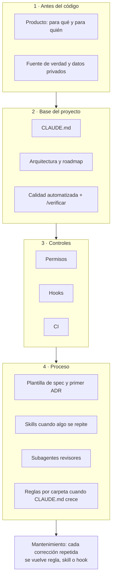
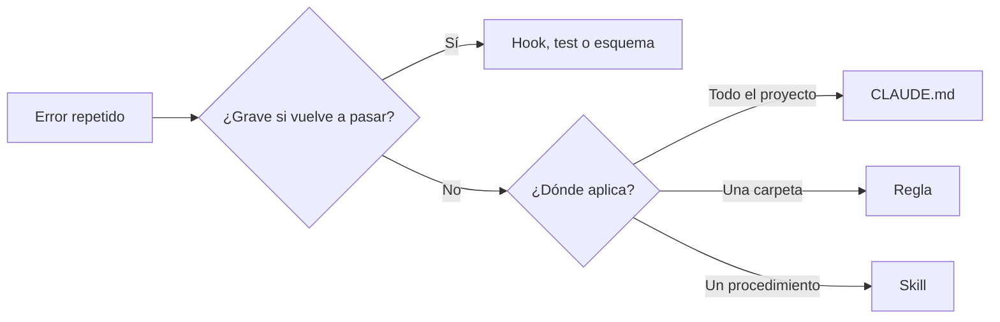

# 8 · Armar un proyecto desde cero

Este capítulo es la receta para replicar la estructura en un repositorio
nuevo. El orden importa: cada paso se apoya en el anterior, y casi todos se
pueden hacer **con ayuda de Claude**. Para cada paso hay un pedido de ejemplo.

## 8.1 El orden, de un vistazo

No hace falta tener todo el primer día. Lo mínimo para arrancar bien son los
pasos 1 a 6; el resto se agrega cuando aparece la necesidad.

## 8.2 Paso a paso

### Paso 1 · Escribí el "para qué"

`docs/PRODUCTO.md`: objetivo, público, qué tiene que lograr. Una página
alcanza. Es lo que evita que el agente construya algo correcto pero inútil.

> Pedido: _"Quiero hacer [proyecto]. Haceme preguntas, de a una tanda, para
> escribir `docs/PRODUCTO.md` con objetivo, público y estructura. No escribas
> código."_

### Paso 2 · Definí la fuente de verdad y lo privado

Dónde viven los datos reales (en este repo, `docs/contenido/` y `docs/casos/`)
y qué no se publica nunca. Si hay material privado, agregalo al `.gitignore`
**antes** del primer commit (`docs/privado/`).

### Paso 3 · `CLAUDE.md`

Ejecutá `/init`: Claude lee el proyecto y genera un borrador. Después
completalo con lo que solo vos sabés: reglas de negocio, datos que no se
publican, convenciones. Mantenelo corto (el de este repo tiene unas 120 líneas).

> Pedido: _"Revisá el `CLAUDE.md` que generó `/init`. Agregá las reglas de
> `docs/PRODUCTO.md` como prohibiciones concretas y sacá lo que se deduce
> leyendo el código."_

### Paso 4 · Arquitectura y roadmap

`docs/ARQUITECTURA.md` con las decisiones (stack, carpetas) y
`docs/ROADMAP.md` con **fases chicas** y casillas `- [ ]`. Cada fase es una
unidad de trabajo para una sesión.

> Pedido (en modo plan): _"Proponé la arquitectura y un roadmap por fases
> para `docs/PRODUCTO.md`. Para cada decisión, dame alternativas y por qué
> elegirías una."_

### Paso 5 · Calidad automatizada antes de la primera feature

Formatter (Prettier), linter (ESLint), tipos estrictos, un test unitario, un
test e2e y el skill `/verificar` que los corre. **Sin esto, el agente no
tiene forma de saber si rompió algo**, y vos tampoco.

> Pedido: _"Configurá Prettier, ESLint, Vitest y Playwright con un test de
> ejemplo cada uno. Después creá el skill `/verificar` que los corra en orden
> y frene en el primer error."_

### Paso 6 · Permisos

`.claude/settings.json` con `allow` para lo frecuente e inocuo y `deny` para
lo irreversible (`git push`, borrar, leer secretos).

> Pedido: _"Creá `.claude/settings.json` con permisos: permitir los scripts de
> `package.json` y `git status/diff/log`; preguntar para commit e install;
> prohibir push, `rm -rf` y leer `.env`."_

### Paso 7 · Hooks

Al menos dos: formato automático después de editar y protección de archivos
generados o sensibles. Probalos con `echo '…' | node hook.mjs` (capítulo 4).

### Paso 8 · CI

Las mismas verificaciones de `/verificar` en GitHub Actions
(`.github/workflows/ci.yml`). Es la red que atrapa lo que se escapó en local.

### Paso 9 · Specs y ADR

Plantilla de spec (`docs/specs/_plantilla.md`), el skill `/spec`, y el primer
ADR (el stack). A partir de acá, toda funcionalidad empieza por `/spec`.

### Paso 10 · Skills cuando algo se repite

La segunda vez que escribís los mismos pasos en un pedido, pedí:
_"Convertí lo que acabamos de hacer en un skill `/nombre`"._

### Paso 11 · Subagentes revisores

Uno de código y, si hay contenido, uno de texto. Herramientas de solo
lectura. `/agents` tiene un asistente para crearlos.

### Paso 12 · Reglas por carpeta

Cuando `CLAUDE.md` empieza a tener secciones que solo aplican a una carpeta,
movelas a `.claude/rules/` con `paths:`.

### Paso 13 · Mantenimiento

Cada vez que corregís al agente por lo mismo dos veces, preguntate dónde
faltaba la información y agregala:

## 8.3 Checklist

- [ ] `docs/PRODUCTO.md`
- [ ] Fuente de verdad definida y `docs/privado/` en `.gitignore`
- [ ] `CLAUDE.md` (corto, con prohibiciones concretas)
- [ ] `docs/ARQUITECTURA.md` y `docs/ROADMAP.md` por fases
- [ ] Prettier, ESLint, tipos estrictos, Vitest, Playwright
- [ ] Skill `/verificar`
- [ ] `.claude/settings.json` con permisos
- [ ] Hooks de formato y protección, probados
- [ ] CI en GitHub Actions
- [ ] Plantilla de spec, skill `/spec` y primer ADR
- [ ] Subagente revisor
- [ ] `CLAUDE.local.md` en `.gitignore`

## Resumen

- Primero el para qué y la fuente de verdad; después la base; después los
  controles; al final el proceso.
- La calidad automatizada va antes de la primera feature.
- Casi todo se puede construir pidiéndoselo a Claude, siempre revisando el resultado.

Anterior: [7 · Flujos de trabajo](07-flujos-de-trabajo.md) ·
Siguiente: [9 · Buenas prácticas](09-buenas-practicas.md)
