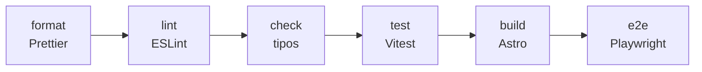

# 9 · Tutorial: proyecto base y calidad

Con el contenido definido, toca crear el proyecto: Astro con React,
TypeScript y Tailwind, y las herramientas que comprueban la calidad
(formato, lint, tipos y tests). La regla de este capítulo: **la calidad
automatizada va antes de la primera funcionalidad**. Sin ella, ni Claude ni
vos tienen forma de saber si algo se rompió.

## 9.1 El stack y por qué

| Pieza          | Elección                | Por qué (ver [ADR 0001](../adr/0001-astro-con-islas-react.md)) |
| -------------- | ----------------------- | -------------------------------------------------------------- |
| Framework      | Astro (salida estática) | HTML sin JavaScript por defecto: rápido y bueno para SEO       |
| Interactividad | Islas de React          | React solo donde hace falta (las demos)                        |
| Lenguaje       | TypeScript estricto     | El compilador atrapa errores antes que el usuario              |
| Estilos        | Tailwind CSS            | Rápido de iterar con la IA, sin CSS suelto                     |
| Tests          | Vitest + Playwright     | Unitarios para la lógica, e2e para lo que ve el usuario        |
| Deploy         | Netlify                 | Gratis, con deploy automático desde GitHub                     |

Si trabajás con otro stack (Next.js, Vue, Laravel), el **proceso** del
tutorial es el mismo; cambian los comandos.

## 9.2 Crear el proyecto

El asistente de Astro pide una carpeta vacía, y la tuya ya tiene `docs/` y
`.gitignore` (capítulo 8). Por eso se crea el proyecto en una carpeta
temporal y se copia al repositorio (en Git Bash, parado en `mi-portfolio`):

```bash
npm create astro@latest ../astro-temporal -- --template minimal --no-git
cp -rn ../astro-temporal/. .     # copia sin pisar tus archivos
rm -rf ../astro-temporal
npm install
```

Revisá `.gitignore`: si Astro trajo el suyo, juntá las dos listas. Después
sumá las integraciones:

```bash
npx astro add react mdx sitemap
npx astro add tailwind
```

Y en `tsconfig.json` usá la configuración más estricta:

```json
{ "extends": "astro/tsconfigs/strictest" }
```

Comprobá que arranca: `npm run dev` y abrí http://localhost:4321.

## 9.3 Las herramientas de calidad

Esto ya conviene pedírselo a Claude. Abrí una sesión
(`claude --add-dir ../portfolio-referencia`) y pedí:

> _"Configurá las herramientas de calidad como en `../portfolio-referencia`:
> Prettier (con los plugins de Astro y Tailwind, misma configuración de
> `.prettierrc`), ESLint (typescript-eslint, astro, react-hooks y
> jsx-a11y-x, sin `any`), Vitest con un test de ejemplo en `src/lib/` y
> Playwright (desktop y mobile) con un test que abra la home. Agregá a
> `package.json` los scripts `format`, `format:check`, `lint`, `check`,
> `test` y `e2e`. Corré cada uno y mostrame el resultado."_



| Herramienta   | Qué atrapa                                                               |
| ------------- | ------------------------------------------------------------------------ |
| Prettier      | Formato inconsistente (y discusiones de estilo)                          |
| ESLint        | Errores comunes, hooks de React mal usados, problemas de accesibilidad   |
| `astro check` | Errores de tipos en `.ts` y `.astro`                                     |
| Vitest        | Lógica que deja de cumplir sus reglas                                    |
| Playwright    | Páginas rotas, flujos que fallan, violaciones de accesibilidad (con axe) |

## 9.4 `CLAUDE.md`

Ahora que hay código, generá el borrador con:

```text
/init
```

Y después completalo con lo que solo vos sabés:

> _"Mejorá el `CLAUDE.md` que generó `/init` tomando como modelo
> `../portfolio-referencia/CLAUDE.md`: qué es el proyecto y su objetivo
> (según `docs/PRODUCTO.md`), stack, comandos, la regla de fuente de verdad
> (`docs/contenido/` y `docs/casos/`, no inventar datos), la lista de datos
> que nunca se publican, y las convenciones. Corto: lo que aplica siempre."_

Revisalo línea por línea: es lo que Claude va a leer en **cada** sesión
(capítulo 3).

## 9.5 El skill `/verificar`

El primer skill que vale la pena tener: corre todas las verificaciones en
orden y frena en el primer error.

> _"Copiá `../portfolio-referencia/.claude/skills/verificar/SKILL.md` a
> `.claude/skills/verificar/` y adaptalo a este proyecto."_

Probalo escribiendo `/verificar`. A partir de ahora, ninguna tarea está
terminada si `/verificar` no pasa.

## 9.6 Commit

```text
/verificar
```

Si todo está en verde:

```bash
git add .
git commit -m "chore: proyecto Astro con calidad automatizada y CLAUDE.md"
git push
```

## Cómo sabés que salió bien

- [ ] `npm run dev` muestra la página inicial de Astro.
- [ ] `npm run lint`, `npm run check`, `npm test` y `npm run e2e` pasan.
- [ ] `CLAUDE.md` describe tu proyecto con tus reglas, no las de otro.
- [ ] `/verificar` corre todo y te muestra una tabla con el resultado.

## Resumen

- Astro + React + TypeScript estricto + Tailwind; tests con Vitest y Playwright.
- La calidad automatizada va antes de la primera funcionalidad.
- `/init` genera el `CLAUDE.md`; vos lo completás con tus reglas.
- `/verificar` es la definición de "terminado".

Anterior: [8 · Tutorial: producto y contenido](08-producto-y-contenido.md) ·
Siguiente: [10 · Tutorial: Claude Code en tu repositorio](10-claude-code-en-tu-repo.md)
