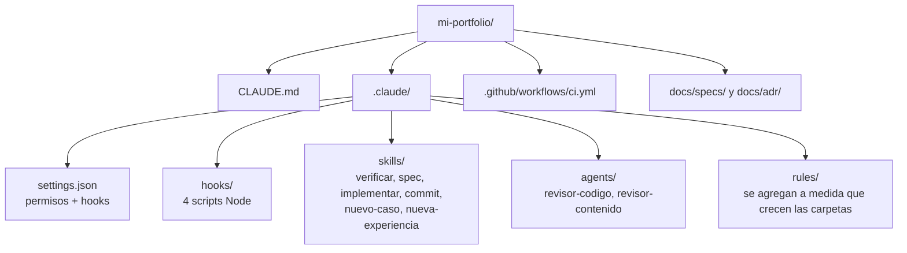
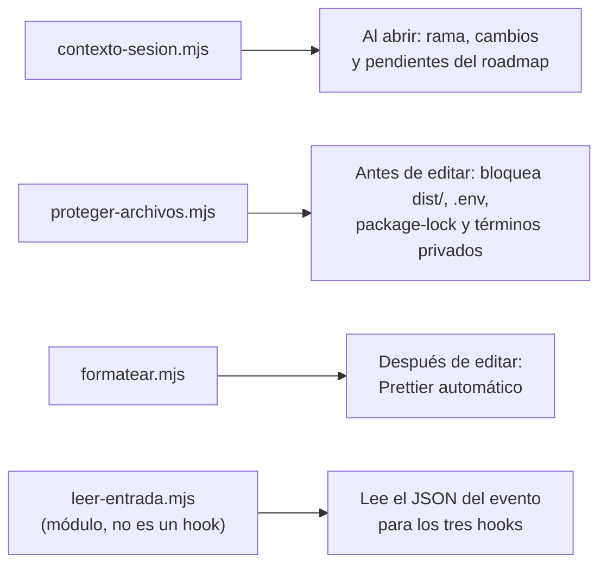

# 10 · Tutorial: Claude Code en tu repositorio

En este capítulo armás la "caja de herramientas" de Claude Code en tu
proyecto: permisos, hooks, skills, subagentes revisores, plantillas de spec y
ADR, y el CI. Casi todo se copia del repositorio de referencia y se adapta:
lo importante es que entiendas qué hace cada pieza (capítulos 3 a 6) para
poder ajustarla a tu caso.

## 10.1 Lo que vas a tener al final



## 10.2 Permisos

> _"Copiá `../portfolio-referencia/.claude/settings.json` a `.claude/`, por
> ahora solo la sección `permissions`. Ajustá la lista `allow` a los scripts
> que existen en mi `package.json`."_

Revisá el resultado con este criterio (capítulo 4):

| Lista   | Qué poner                                                      |
| ------- | -------------------------------------------------------------- |
| `allow` | Scripts de `package.json`, `git status`, `git diff`, `git log` |
| `ask`   | `git commit`, `npm install`                                    |
| `deny`  | `git push`, `rm -rf`, leer `.env`                              |

El `git push` prohibido no es desconfianza: en el capítulo 13 vas a conectar
Netlify, y cada push publica el sitio. Publicar tiene que ser una decisión tuya.

## 10.3 Hooks

> _"Copiá los scripts de `../portfolio-referencia/.claude/hooks/` (tres hooks
> y el módulo compartido `leer-entrada.mjs`) y
> registrá en `.claude/settings.json` los hooks `SessionStart`, `PreToolUse`
> y `PostToolUse` igual que en la referencia. Explicame qué hace cada uno."_

Después **probalos vos** (en Git Bash), sin abrir Claude:

```bash
# Tiene que bloquear (código 2): dist/ es salida del build
echo '{"tool_input":{"file_path":"dist/index.html"}}' \
  | node .claude/hooks/proteger-archivos.mjs; echo "código: $?"

# Tiene que pasar (código 0)
echo '{"tool_input":{"file_path":"src/pages/index.astro","new_string":"hola"}}' \
  | node .claude/hooks/proteger-archivos.mjs; echo "código: $?"
```

Y probá el de privacidad con una palabra de tu `docs/privado/terminos-sensibles.txt`:

```bash
echo '{"tool_input":{"file_path":"src/x.ts","content":"PALABRA-DE-TU-LISTA"}}' \
  | node .claude/hooks/proteger-archivos.mjs; echo "código: $?"
```



Si la lista de archivos protegidos no coincide con tu proyecto (por
ejemplo, no tenés `legacy/`), pedile a Claude que la ajuste.

## 10.4 Skills

Copiá y **adaptá** (los de la referencia mencionan a su autor y sus rutas):

> _"Copiá estos skills de `../portfolio-referencia/.claude/skills/`:
> `spec`, `implementar`, `commit`, `nuevo-caso` y `nueva-experiencia`.
> Reemplazá el nombre del autor por el mío, ajustá las rutas y los comandos a
> este proyecto y sacá lo que no aplique (por ejemplo, el CV en PDF si
> todavía no lo tengo). Mostrame qué cambiaste en cada uno."_

| Skill                | Lo vas a usar para                       | Capítulo |
| -------------------- | ---------------------------------------- | -------- |
| `/verificar`         | Saber si todo sigue funcionando          | 9        |
| `/spec`              | Acordar qué construir antes de programar | 11       |
| `/implementar`       | Construir una spec aprobada con TDD      | 11       |
| `/nuevo-caso`        | Pasar un caso de `docs/casos/` al sitio  | 12       |
| `/nueva-experiencia` | Sumar un trabajo nuevo sin tocar código  | 14       |
| `/commit`            | Commits con formato Conventional Commits | —        |

`/nueva-demo` conviene sumarlo cuando tengas tu primera demo (capítulo 12):
lista los archivos de una demo y depende de cómo armes la tuya.

## 10.5 Subagentes revisores

> _"Copiá `../portfolio-referencia/.claude/agents/revisor-codigo.md` y
> `revisor-contenido.md` y adaptalos: mi nombre, mis fuentes de verdad, mi
> tono. Tienen que quedar con herramientas de solo lectura."_

Revisá que el encabezado `tools:` no incluya `Edit` ni `Write` (capítulo 5).

## 10.6 Specs, ADR y CI

> _"Copiá `docs/specs/_plantilla.md`, `docs/specs/README.md` (vaciá el
> índice) y `docs/adr/README.md` de la referencia. Escribí el ADR 0001 con
> el stack que elegimos en el capítulo 9 y sus alternativas. Después copiá
> `.github/workflows/ci.yml`."_

El CI corre en GitHub las mismas verificaciones técnicas que `/verificar`
(formato, lint, tipos, tests, build y e2e; el control de términos privados
queda en tu máquina, porque la lista no está en git), en cada
push a `main` y en cada pull request.

## 10.7 Commit y prueba de fuego

```text
/verificar
/commit
```

Después de commitear, hacé el push vos (`git push`) y mirá la pestaña
**Actions** de tu repositorio en GitHub: el CI tiene que quedar en verde.

## Cómo sabés que salió bien

- [ ] Los tres `echo … | node …` devuelven el código esperado.
- [ ] Al abrir `claude`, el hook de inicio muestra la rama y los pendientes.
- [ ] Después de una edición de Claude, el archivo queda formateado solo.
- [ ] `/spec`, `/implementar`, `/commit` y los revisores aparecen y hablan de **tu** proyecto.
- [ ] El CI está en verde en GitHub.

## Resumen

- Permisos: lo frecuente sin preguntar, lo irreversible prohibido.
- Hooks: se copian, se registran y **se prueban** con `echo … | node`.
- Skills y agentes: se copian y se adaptan a tu nombre, rutas y proyecto.
- Plantillas de spec y ADR, y el CI como red final.

Anterior: [9 · Tutorial: proyecto base y calidad](09-proyecto-base-y-calidad.md) ·
Siguiente: [11 · Tutorial: construir el sitio con specs](11-construir-el-sitio.md)
