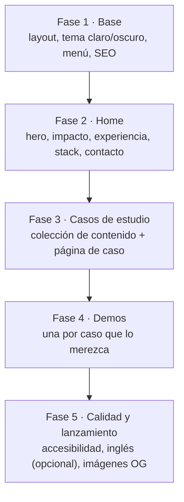
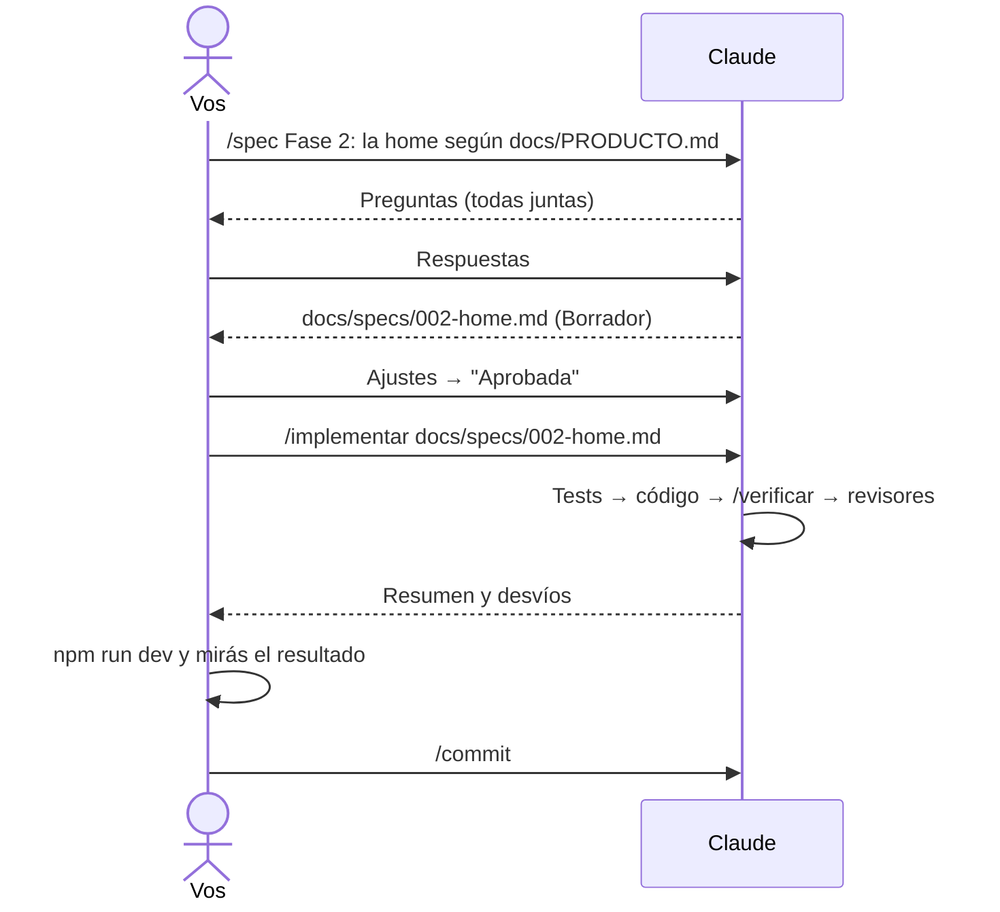

# 11 · Tutorial: construir el sitio con specs

Con la base lista, se construye el sitio por **fases**: cada fase es una
spec que vos aprobás y Claude implementa. Este capítulo muestra cómo armar
el roadmap, cómo escribir la spec de la home paso a paso y cómo revisar el
resultado sin perder el control del diseño.

## 11.1 El roadmap por fases

> _"Leé `docs/PRODUCTO.md` y proponé `docs/ROADMAP.md` con fases chicas y
> casillas `- [ ]`, tomando como ejemplo `../portfolio-referencia/docs/ROADMAP.md`.
> Cada fase tiene que poder hacerse en una sesión."_

Un orden que funciona (simplificado a partir del de este portfolio):



## 11.2 Una fase, de punta a punta

Para cada fase el ciclo es siempre el mismo (capítulos 6 y 14):



### Ejemplo: la spec de la home

```text
/spec Fase 2: la home del portfolio según docs/PRODUCTO.md. Secciones: hero
con propuesta de valor y botones (ver casos, descargar CV, contacto), franja
de impacto solo con métricas reales, experiencia desde docs/contenido,
stack agrupado y contacto con formulario de Netlify Forms. Sin React en la
home.
```

Lo que tenés que revisar en el borrador:

- **Fuera de alcance:** ¿quedó afuera lo que no querés ahora?
- **Criterios de aceptación:** ¿se pueden comprobar? ("el puesto actual
  aparece primero" sí; "se ve lindo" no).
- **Datos:** ¿todo sale de `docs/`? Lo que falte tiene que estar como
  `TODO(contenido)`, no inventado.

## 11.3 El diseño sin perder el control

La IA tiende a diseños genéricos si no le das dirección. Tres técnicas:

1. **Modo plan con alternativas:** _"Proponé dos alternativas de hero con
   pros y contras antes de tocar código."_
2. **Referencias concretas:** una captura o la URL de un sitio que te guste,
   y qué te gusta de él.
3. **Tokens de diseño:** pedí que los colores sean variables (como en
   `src/styles/global.css` de la referencia) para que el modo claro y oscuro
   salgan solos y el contraste se pueda verificar.

Y siempre: `npm run dev`, mirá el resultado en el navegador (también en el
celular) y pedí ajustes concretos ("el título del hero ocupa tres líneas en
mobile; que entre en dos").

## 11.4 Reglas por carpeta, cuando aparezcan

A medida que se crean carpetas con convenciones propias, sumá reglas
(capítulo 3):

> _"Creá `.claude/rules/logica-pura.md` para `src/lib/**` con las reglas de
> `../portfolio-referencia/.claude/rules/logica-pura.md`, adaptadas."_

Lo mismo para `src/islands/**` (islas de React), contenido e `e2e/**`.

## 11.5 Idioma inglés (opcional)

Si tu público es internacional, sumalo como fase aparte cuando el sitio en
español esté terminado: rutas bajo `/en/`, diccionarios de textos con el
mismo tipo (así una clave faltante rompe el build) y `hreflang`. La
referencia lo resuelve en `src/i18n/`.

## Cómo sabés que salió bien

- [ ] `docs/ROADMAP.md` tiene fases chicas con casillas.
- [ ] Cada fase tiene su spec aprobada en `docs/specs/` antes del código.
- [ ] La home muestra tu contenido real, sin datos inventados.
- [ ] `/verificar` y el CI pasan después de cada fase.

## Resumen

- El sitio se construye por fases; cada fase es una spec.
- Vos aprobás la spec y revisás el resultado en el navegador.
- El diseño se dirige con alternativas, referencias y tokens.
- Las reglas por carpeta aparecen cuando aparecen las carpetas.

Anterior: [10 · Tutorial: Claude Code en tu repositorio](10-claude-code-en-tu-repo.md) ·
Siguiente: [12 · Tutorial: casos de estudio y demos](12-casos-y-demos.md)
