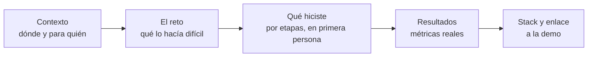
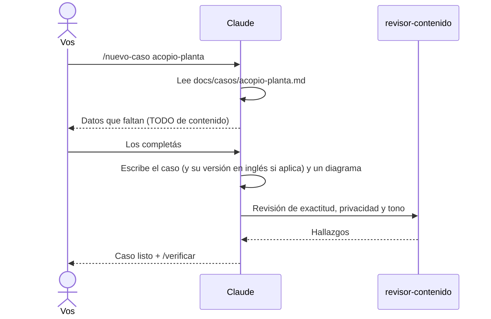
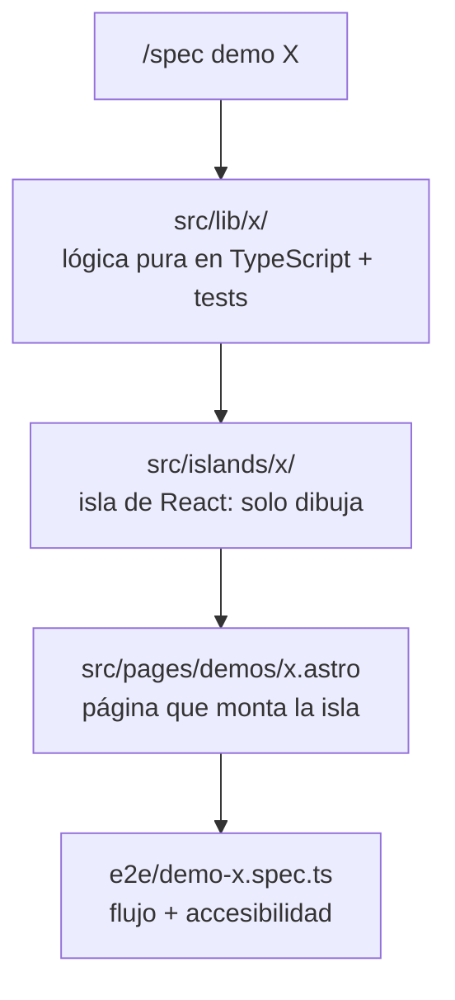

# 12 · Tutorial: casos de estudio y demos

Los casos de estudio y las demos son lo que separa a este portfolio de un CV
en formato web: no dicen "sé hacer X", lo **muestran**. En este capítulo
pasás tus borradores de `docs/casos/` al sitio y, si un caso lo merece,
construís una demo que se pueda usar en el navegador.

## 12.1 Qué hace bueno a un caso de estudio



Un recruiter lo lee en 30 segundos; un tech lead, en 5 minutos. Por eso la
página de caso de la referencia empieza con un resumen "En 30 segundos"
(problema / qué hice / impacto) y después desarrolla.

| Frase floja                      | Frase que se defiende en una entrevista                                                                             |
| -------------------------------- | ------------------------------------------------------------------------------------------------------------------- |
| "Trabajé en un sistema de stock" | "Desarrollé la planificación de producción del nuevo acopio: la espera de los camiones pasó de hasta 3 días a cero" |
| "Usé muchas tecnologías"         | "Lo modelé como un problema de corte con programación lineal entera: menos acero, cumpliendo la demanda"            |
| "Mejoré mucho el rendimiento"    | "La consulta pasó de X s a Y ms, medido en producción" (con tus números reales)                                     |

## 12.2 Del borrador a la página

Primero, una fase con su spec para la **colección de casos** (el esquema que
valida cada caso y la plantilla de página). Pedila con `/spec` mirando cómo
lo resuelve la referencia (`src/content.config.ts` y
`src/components/caso/`). Con eso listo, cada caso se pasa con:

```text
/nuevo-caso <slug>
```



El esquema con zod (capítulo 6) hace que un caso mal cargado (resumen
demasiado largo, métrica sin etiqueta) rompa el build en lugar de publicarse.

## 12.3 Las demos: probar en lugar de contar

Una demo vale la pena cuando un caso afirma algo que se puede **usar**:

| El caso afirma                                         | La demo muestra                                         |
| ------------------------------------------------------ | ------------------------------------------------------- |
| "El negocio cambia formularios sin deploys"            | Un formulario que se arma desde un JSON editable        |
| "Optimicé el corte de acero"                           | Un optimizador que resuelve el problema en el navegador |
| "Participé de un sistema de contingencias sin deploys" | Un simulador donde apagás partes del portal             |

Elegí **una**: la que mejor demuestre tu criterio técnico. Usá datos de
ejemplo ficticios.

### Cómo se construye una demo



La regla clave (capítulo 3): **la lógica va en `src/lib/`, sin React**, con
tests. La isla solo dibuja. Así la lógica se prueba en milisegundos y la
demo se puede rehacer sin tocar las reglas.

> _"/spec una demo para el caso `<slug>`: [qué tiene que poder hacer el
> visitante]. Datos de ejemplo ficticios. Lógica en `src/lib/` con tests,
> isla de React aparte. Mirá cómo están armadas las demos de
> `../portfolio-referencia` (`src/lib/` y `src/islands/`)."_

Cuando tengas la primera, sumá el skill `/nueva-demo` adaptado (capítulo 10):
la segunda va a salir mucho más rápido.

## 12.4 Métricas ilustrativas

Si la demo produce un número ("ahorro estimado de ~X %"), es una métrica
**ilustrativa**: solo puede aparecer junto a la demo, con una aclaración, y
nunca como logro profesional en la home. La referencia lo comprueba con un
test e2e.

## Cómo sabés que salió bien

- [ ] Cada caso tiene su página, con resumen de 30 segundos y métricas etiquetadas.
- [ ] `revisor-contenido` no reporta problemas bloqueantes.
- [ ] Tu demo (si hiciste una) tiene la lógica en `src/lib/` con tests y un e2e.
- [ ] Ninguna métrica ilustrativa aparece fuera de su demo.

## Resumen

- Un caso: contexto → reto → qué hiciste → resultados → stack.
- `/nuevo-caso` pasa el borrador al sitio y lo hace revisar.
- Una demo convierte una afirmación en algo que se puede usar.
- Lógica en `src/lib/` con tests; la isla solo dibuja.

Anterior: [11 · Tutorial: construir el sitio con specs](11-construir-el-sitio.md) ·
Siguiente: [13 · Tutorial: publicar y mantener](13-publicar-y-mantener.md)
