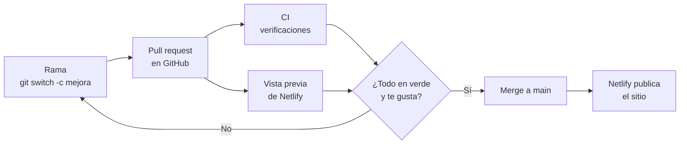
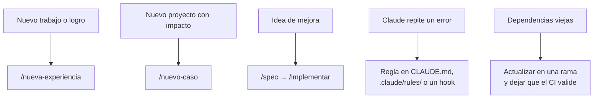

# 13 · Tutorial: publicar y mantener

Último paso: poner el sitio en internet, hacer que lo encuentren y
mantenerlo vivo. Publicar con Netlify lleva unos minutos; lo que importa es
dejar armado un circuito en el que cada cambio pase por las verificaciones
antes de llegar a los visitantes.

## 13.1 Netlify

1. Copiá `netlify.toml` de la referencia a la raíz de tu proyecto (define el
   comando de build, la carpeta publicada, la versión de Node y los headers
   de seguridad). Commit y push.
2. En Netlify: **Add new site / project** → **Import an existing project** →
   **GitHub** → elegí tu repositorio.
3. Confirmá: comando de build `npm run build`, carpeta `dist`. **Deploy.**
4. En unos minutos tenés `https://<nombre>.netlify.app`. Podés cambiar el
   nombre en la configuración del sitio o conectar un dominio propio.

Si usás el formulario de contacto con Netlify Forms, activá la detección de
formularios en la configuración del sitio (sección **Forms**) y configurá a
qué email llegan.

## 13.2 El circuito de publicación

Para cambios chicos podés trabajar directo en `main`, pero para algo grande
(una sección nueva, un rediseño) conviene una **rama** y un **pull request**:
el CI corre las verificaciones y Netlify suele generar una vista previa con
su propia URL. Revisás tranquilo y, si te convence, hacés el merge. Esta
misma guía se agregó así al portfolio.

## 13.3 Que te encuentren

- **Google Search Console:** agregá tu sitio, verificá la propiedad (con la
  opción de etiqueta HTML: la agregás al `<head>` de tu layout y publicás) y enviá el sitemap
  (`/sitemap-index.xml`, lo genera `@astrojs/sitemap`).
- **LinkedIn y GitHub:** poné el enlace en tu perfil, en la sección
  destacada y en el README de tu perfil de GitHub.
- **Imágenes para compartir (Open Graph):** cada página con su imagen hace
  que el enlace se vea bien en LinkedIn o WhatsApp. La referencia las genera
  con un script (`npm run og`); pedile a Claude una spec para replicarlo.

## 13.4 Mantenerlo vivo

- **Experiencia:** cuando cambiás de trabajo, `/nueva-experiencia` te
  entrevista y actualiza el sitio (capítulo 14).
- **El repositorio aprende:** cada vez que corregís a Claude dos veces por lo
  mismo, agregá la regla donde corresponda (capítulo 15).
- **Actualizaciones:** subí dependencias en una rama; el CI te dice si algo
  se rompió antes de que llegue al sitio.

## 13.5 Checklist final

- [ ] El sitio está publicado en Netlify y se actualiza con cada push a `main`.
- [ ] El formulario de contacto llega a tu email (si lo usás).
- [ ] El sitemap está enviado en Search Console.
- [ ] El enlace está en LinkedIn y en GitHub.
- [ ] El CI está en verde (opcional: en GitHub, Settings → Branches, una
      regla que lo exija antes de mergear a `main`).
- [ ] Sabés qué skill usar para cada mantenimiento.

## Resumen

- Netlify publica el sitio desde GitHub con `netlify.toml`.
- Cambios grandes: rama → pull request → CI y vista previa → merge.
- Search Console, LinkedIn e imágenes OG para que te encuentren.
- El mantenimiento también tiene su skill; el repositorio aprende de cada error.

¡Listo! Los capítulos que siguen son de referencia para el día a día.

Anterior: [12 · Tutorial: casos de estudio y demos](12-casos-y-demos.md) ·
Siguiente: [14 · Flujos de trabajo](14-flujos-de-trabajo.md)
