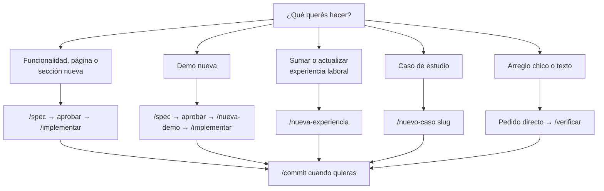
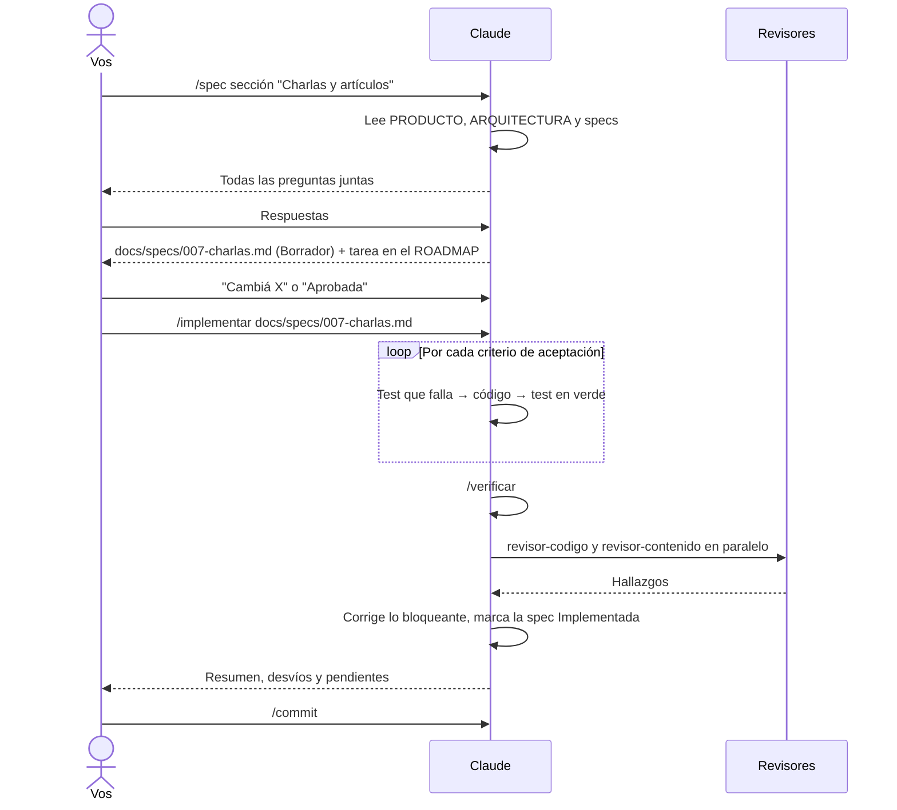
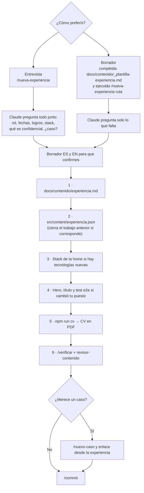
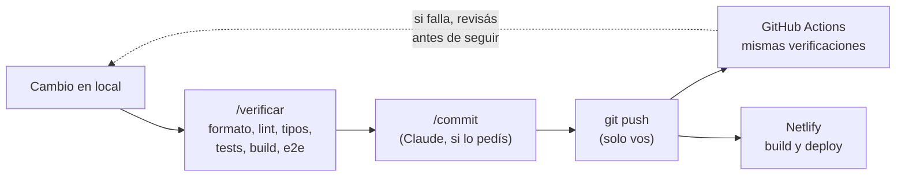

# 14 · Flujos de trabajo paso a paso

Con todas las piezas presentadas, este capítulo las junta en los flujos que
vas a usar de verdad: una funcionalidad nueva, una experiencia laboral, un
caso de estudio, un arreglo chico y el camino de un cambio hasta que el sitio
se publica. Cada flujo muestra qué escribís vos y qué hace Claude.

## 14.1 Cuál flujo usar



## 14.2 Funcionalidad nueva



Lo que te toca a vos: responder las preguntas, aprobar la spec y revisar el
resultado. El resto lo guían los skills.

## 14.3 Sumar experiencia laboral

Pensado para que solo tengas que contar lo que hiciste. Hay dos caminos:



Ejemplos de cómo arrancar:

```text
/nueva-experiencia
/nueva-experiencia Entré a una empresa como Tech Lead en marzo
/nueva-experiencia docs/contenido/borrador-consultora.md
```

Para cada logro, Claude te va a pedir tres cosas: **qué problema había, qué
hiciste vos (o el equipo, y cuál fue tu parte) y qué cambió**. Es el formato
que convierte una lista de tareas en impacto, y lo que un recruiter busca.

## 14.4 Caso de estudio

```text
/nuevo-caso <slug>
```

Si existe `docs/casos/<slug>.md`, esa es la fuente. Si no, Claude la crea con
la estructura y te pide confirmar los datos marcados `TODO(contenido)`.
Después genera las versiones ES y EN, los diagramas, corre `/verificar` y le
pide una revisión a `revisor-contenido`.

## 14.5 Arreglo chico

Para un texto mal escrito o un bug puntual no hace falta spec:

```text
En la página del caso de acopio, en inglés, "stock" aparece como "stok".
Corregilo y corré /verificar.
```

Si el bug está en `src/lib/`, pedí primero un test que lo reproduzca: así
queda cubierto para siempre.

## 14.6 Del cambio a la publicación



El CI (`.github/workflows/ci.yml`) repite los mismos pasos que `/verificar`.
Si algo se escapó en local, aparece ahí en rojo en la pestaña _Actions_ del
repositorio.

## 14.7 Ejemplo de una conversación (ficticia y abreviada)

```text
Vos:    /nueva-experiencia Entré a una empresa como Tech Lead en marzo

Claude: Para armarla necesito:
        1. ¿Nombre de la consultora y se puede publicar? ¿Cliente (anónimo)?
        2. Ubicación y modalidad (ej. "Córdoba · Remoto").
        3. ¿Tu trabajo actual termina en febrero? ¿En qué fecha exacta?
        4. Logros: para cada uno, problema → qué hiciste → qué cambió.
        5. Stack que usás de verdad.
        6. ¿Algo confidencial (sistemas, clientes)?
        7. ¿Hay algo con impacto medible para un caso de estudio?

Vos:    (respondés)

Claude: Borrador ES / EN: … ¿Lo confirmo?

Vos:    Sí

Claude: Actualicé experiencia.md, experiencia.json (cerré el trabajo anterior),
        agregué 2 tecnologías al stack, cambié el rol del hero y el test e2e,
        regeneré el CV. /verificar: todo OK. revisor-contenido: sin hallazgos
        bloqueantes. ¿Hago el commit?
```

## Resumen

- Funcionalidad: `/spec` → aprobar → `/implementar`.
- Experiencia: `/nueva-experiencia`, por entrevista o con la plantilla.
- Caso: `/nuevo-caso`. Arreglo chico: directo + `/verificar`.
- Claude puede commitear si se lo pedís; el push y la publicación son tuyos.

Anterior: [13 · Tutorial: publicar y mantener](13-publicar-y-mantener.md) ·
Siguiente: [15 · Buenas prácticas](15-buenas-practicas.md)
