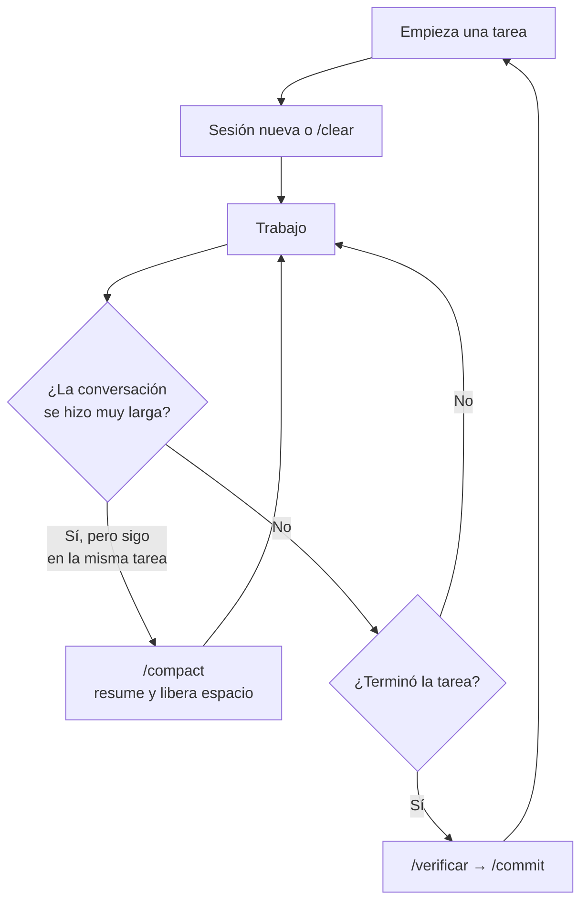

# 15 · Buenas prácticas y problemas comunes

Este capítulo junta los hábitos que más diferencia hacen al trabajar con un
agente, cómo cuidar el contexto, qué tener en cuenta de seguridad y una tabla
para cuando algo sale mal.

## 15.1 Hábitos que conviene tener

| Hacé                                                  | Por qué                                            |
| ----------------------------------------------------- | -------------------------------------------------- |
| Pedí resultados verificables ("que pase `npm test`")  | "Terminado" deja de ser una opinión                |
| Una tarea por sesión; `/clear` entre tareas distintas | El contexto no arrastra ruido de la tarea anterior |
| Usá el modo plan para cambios grandes o poco claros   | Corregís el rumbo antes de que haya código         |
| Señalá archivos con `@` o con la ruta                 | Menos búsquedas, menos confusiones                 |
| Pedí que pregunte si le falta un dato                 | Evita que complete con lo probable                 |
| Revisá el diff antes de commitear                     | El agente puede equivocarse con mucha confianza    |
| Cuando algo sale mal, buscá qué faltaba en el repo    | Cada corrección mejora todas las sesiones futuras  |

| Evitá                                                     | Por qué                                                    |
| --------------------------------------------------------- | ---------------------------------------------------------- |
| `CLAUDE.md` gigantes                                      | Lo importante se diluye y se gasta contexto en cada sesión |
| Instrucciones vagas ("buenas prácticas", "código limpio") | No se pueden comprobar                                     |
| Confiar en una instrucción para algo crítico              | Si no puede fallar, es un hook, un test o un esquema       |
| Desactivar lint, tests o hooks para "destrabar"           | Se esconde el problema; se corrige la causa                |
| Aceptar permisos sin leer el comando                      | Es tu máquina y tu repositorio                             |
| Pegar datos privados o secretos en el chat                | Quedan en el historial y pueden terminar en un archivo     |

## 15.2 Cuidar el contexto

- `/context` muestra cuánto espacio está ocupado.
- Si Claude empieza a "olvidar" algo que dijiste al principio, probablemente
  el contexto se resumió: repetí lo importante o, mejor, escribilo en un
  archivo del repo.
- Los subagentes ayudan a ahorrar contexto: su lectura queda en su sesión.

## 15.3 Seguridad

- **Secretos:** nunca en el repositorio ni en el chat. `.env` está prohibido
  para lectura y escritura en este repo.
- **Contenido externo:** si le pegás texto de una web, un PDF o un email,
  puede traer instrucciones escondidas ("ignorá lo anterior y…"). Claude
  Code está preparado para tratarlo como datos, pero conviene saber que
  existe el riesgo y revisar qué hace después.
- **Comandos:** leé lo que vas a autorizar. Un `allow` amplio (`Bash(*)`)
  elimina la protección.
- **Publicación:** en este repo el `git push` es siempre tuyo.

## 15.4 Cuando algo sale mal

| Síntoma                                      | Causa probable                                            | Qué hacer                                                                |
| -------------------------------------------- | --------------------------------------------------------- | ------------------------------------------------------------------------ |
| Inventó un dato (fecha, métrica, tecnología) | No estaba en la fuente de verdad o no la leyó             | Corregilo en `docs/contenido/` y pedile que regenere desde ahí           |
| Ignoró una regla                             | La regla es vaga, está enterrada o el contexto se resumió | Hacela concreta; si es crítica, convertila en hook o test                |
| Un hook bloquea algo que querés hacer        | El hook hace su trabajo                                   | Leé el motivo; cambiá el origen (`src/`), no el archivo protegido        |
| Hizo más de lo que pediste                   | Faltó "fuera de alcance"                                  | `Esc` `Esc` para volver; usá `/spec` o aclará qué no tocar               |
| Dice "listo" pero el build falla             | No verificó                                               | Pedí `/verificar`; el CI lo detecta igual                                |
| Se trabó en un error, prueba y prueba        | Le falta información o el enfoque es malo                 | `Esc`, explicale qué sabés del problema o pedí modo plan para replantear |
| Las respuestas se vuelven raras o lentas     | Contexto muy lleno                                        | `/compact` o `/clear` y retomá con un resumen                            |
| Cambió un archivo que no querías             | Pedido ambiguo                                            | `/rewind` o `git checkout -- archivo`, y agregá la restricción al pedido |

## Resumen

- Pedidos verificables, una tarea por sesión, modo plan para lo grande, diff
  revisado siempre.
- El contexto se cuida con `/clear`, `/compact` y subagentes.
- Secretos fuera del repo y del chat; el push es tuyo.
- Cada error repetido es una pista de qué falta escribir en el repositorio.

Anterior: [14 · Flujos de trabajo](14-flujos-de-trabajo.md) ·
Siguiente: [16 · Glosario](16-glosario.md)
