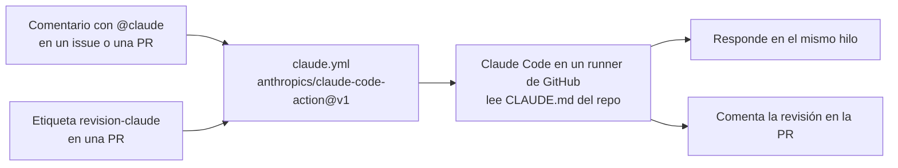

# 16 · Tutorial: Claude Code en CI

Tu sitio ya se publica con cada push y el CI corre las verificaciones. Este
capítulo suma a Claude al circuito de GitHub: responde cuando lo mencionás
con `@claude` en un issue o una PR, y revisa una PR cuando le ponés una
etiqueta. Todo a pedido, para que el costo dependa de vos. Al final vas a
saber usar Claude Code sin conversación (`claude -p`) en cualquier pipeline.

> **Aplicación:** En este repo — `.github/workflows/claude.yml`; `claude -p` (16.5) se explica pero el repo no lo usa en scripts.

## 16.1 Lo que vas a tener al final



El CI de siempre (`ci.yml`) no cambia: sigue corriendo formato, lint, tipos,
tests, build y e2e en cada push. Claude **no reemplaza** esas
verificaciones; agrega una revisión con criterio cuando la pedís.

## 16.2 Instalar la app y el secreto

Necesitás dos cosas en GitHub
([documentación](https://code.claude.com/docs/en/github-actions)):

1. **La app "Claude" de GitHub** instalada en tu repositorio. Es la que le da
   permiso para comentar.
2. **El secreto `ANTHROPIC_API_KEY`**, con una clave de API de la
   [Claude Console](https://platform.claude.com). Va en _Settings → Secrets
   and variables → Actions_ del repo. Nunca en un archivo.

El camino corto es abrir `claude` en tu repo y correr `/install-github-app`:
instala la app, guarda el secreto y te prepara una PR con el workflow. Pide
tener `gh` instalado y autenticado (`gh auth login`). Si preferís hacerlo a
mano, seguí con 16.3.

## 16.3 El workflow de este repo

> _"Copiá `../portfolio-referencia/.github/workflows/claude.yml` a mi repo y
> explicame cada parte antes de commitearlo."_

Lo importante del archivo:

```yaml
on:
  issue_comment:
    types: [created]
  pull_request_review_comment:
    types: [created]
  pull_request:
    types: [labeled]

jobs:
  mencion: # responde a @claude
    if: github.event_name != 'pull_request' && contains(github.event.comment.body, '@claude') && github.event.comment.author_association == 'OWNER' # + nunca en PR de forks
    # …
      - uses: anthropics/claude-code-action@v1
        with:
          anthropic_api_key: ${{ secrets.ANTHROPIC_API_KEY }}
          claude_args: '--max-turns 15'

  revision: # revisa la PR cuando le ponés la etiqueta
    if: github.event_name == 'pull_request' && github.event.label.name == 'revision-claude' && github.event.sender.login == github.repository_owner && github.event.pull_request.head.repo.full_name == github.repository
    # …
      - uses: actions/checkout@v6
        with:
          ref: ${{ github.event.pull_request.head.sha }} # el código de la PR
          fetch-depth: 0 # para comparar contra la rama base
      - uses: anthropics/claude-code-action@v1
        with:
          prompt: |
            Revisá la PR #${{ github.event.pull_request.number }} …
            1. Pasale al subagente `revisor-codigo` el diff contra la rama base.
            2. Si cambia texto visible, pasale esos archivos a `revisor-contenido`.
            3. Comentá los hallazgos importantes en su línea …
            4. … y cerrá con un resumen en la PR (`gh pr comment`).
          claude_args: >-
            --max-turns 30
            --allowedTools "Agent,Task,Read,Grep,Glob,Bash(git diff:*),…,Bash(gh pr comment:*),mcp__github_inline_comment__create_inline_comment"
```

**Qué revisa la etiqueta** lo deciden tus propios revisores, los subagentes
de `.claude/agents/` del capítulo 5: `revisor-codigo` (arquitectura, tipos,
tests, accesibilidad, i18n) y `revisor-contenido` (privacidad, exactitud
contra la fuente de verdad, paridad ES/EN). Son los mismos que usás en tu
máquina, así que la PR se revisa con los mismos criterios. Para cambiar qué
miran, editás esos archivos; el workflow no cambia. La alternativa es cargar
en la acción el plugin oficial `code-review@claude-plugins-official`: busca
bugs, pero no conoce las reglas de tu proyecto.

> Los revisores salen de la rama de la PR. Si la PR cambia un revisor, la
> revisión ya usa la versión nueva. Es otra razón para que solo vos puedas
> poner la etiqueta.

| Pieza                         | Por qué                                                                                                          |
| ----------------------------- | ---------------------------------------------------------------------------------------------------------------- |
| `if: … '@claude'`             | El runner ni arranca si el comentario no menciona a Claude                                                       |
| `labeled` + `revision-claude` | La revisión corre una vez, cuando ponés la etiqueta, y no en cada push                                           |
| `--allowedTools`              | Los revisores solo leen; la sesión principal solo puede comentar, no editar ni hacer push                        |
| `--max-turns`                 | Le pone un techo a lo que puede trabajar en una corrida (15 para responder, 30 para revisar con dos subagentes)  |
| `timeout-minutes: 20`         | Corta una corrida que se colgó                                                                                   |
| `concurrency`                 | Una sola corrida por issue o PR a la vez                                                                         |
| `permissions:`                | El `GITHUB_TOKEN` de los dos jobs solo lee; los comentarios los publica la app "Claude" con sus propios permisos |

Quién puede dispararlo, y con qué código:

- La acción ya exige **permiso de escritura** en el repo y rechaza a los
  bots. El workflow es más estricto: solo corre si el comentario es del
  **dueño** (`author_association == 'OWNER'`) o si el dueño puso la etiqueta
  (`sender.login == repository_owner`).
- **Nunca sobre PR de forks.** GitHub no les pasa secretos a los eventos
  `pull_request` que vienen de un fork, pero los **comentarios**
  (`issue_comment`) sí corren con los secretos del repo, aunque la PR sea
  de un fork. Por eso el workflow lo comprueba antes: con
  `head.repo.full_name` cuando el evento lo trae, y con
  `gh pr view --json isCrossRepository` cuando no.
- El token que usa Claude para comentar es el de la **app "Claude"**, que
  tiene sus propios permisos, más amplios que los del bloque
  `permissions:`. Protegé `main` en GitHub (_Settings → Branches_) para
  que nada llegue ahí sin una PR revisada.

## 16.4 Probarlo

1. Abrí una PR de prueba y comentá: `@claude ¿qué cambia esta PR y qué test
falta?`. En un minuto o dos, Claude responde en el mismo hilo.
2. Creá la etiqueta `revision-claude` (_Issues → Labels_) y ponésela a la PR.
   Claude deja comentarios en las líneas con hallazgos bloqueantes o
   importantes, y un resumen con todos los hallazgos, qué revisores
   corrieron y el veredicto.
3. Mirá el consumo en la Claude Console. Cada mención o etiqueta es una
   corrida con costo; sin pedido no hay gasto.

## 16.5 Claude Code sin conversación: `claude -p`

La acción de GitHub usa por dentro el modo **headless**: Claude Code recibe
un pedido, trabaja y termina, sin conversación
([documentación](https://code.claude.com/docs/en/headless)). Lo podés usar en
cualquier script o pipeline:

```bash
claude -p "Revisá el diff de esta rama contra main y listá los riesgos" \
  --allowedTools "Bash(git diff *),Read,Grep" \
  --max-turns 10 \
  --output-format json
```

| Opción                      | Para qué                                                                                        |
| --------------------------- | ----------------------------------------------------------------------------------------------- |
| `-p "…"`                    | Ejecuta el pedido y sale                                                                        |
| `--allowedTools`            | Lo único que puede hacer sin preguntar (en un pipeline no hay nadie para aprobar)               |
| `--max-turns`               | Techo de iteraciones                                                                            |
| `--output-format json`      | Respuesta en JSON, con el texto (`result`), el `session_id` y el costo, para procesarla después |
| `--permission-mode dontAsk` | Rechaza todo lo que no esté pre-aprobado, en lugar de quedarse esperando                        |

Cada `claude -p` es una sesión nueva: no arrastra conversaciones anteriores
ni contexto de otra corrida. Ese **aislamiento** es lo que querés en CI: cada
corrida parte del mismo contexto (el repo y su `CLAUDE.md`), sin arrastrar
nada de corridas anteriores.

## 16.6 Que la revisión automática sea útil

Una revisión que marca de todo se ignora. Para bajar los falsos positivos:

- **Criterios explícitos en `CLAUDE.md` o en el prompt:** qué es bloqueante y
  qué no. "Revisá seguridad" no sirve; "marcá secretos en el código, `any` en
  TypeScript y endpoints sin validación" sí.
- **Pedir evidencia:** que cada hallazgo cite `archivo:línea` y explique cómo
  falla. Si no lo puede explicar, no lo reporta.
- **Separar gravedades:** bloqueante, importante y sugerencia, como hacen los
  revisores de este repo (capítulo 5).
- **No repetir lo que ya controla el CI:** formato y lint los resuelven
  Prettier y ESLint; la revisión se concentra en lo que una herramienta
  determinista no ve.

## Cómo sabés que salió bien

- [ ] El secreto `ANTHROPIC_API_KEY` está en GitHub y en ningún archivo del repo.
- [ ] Un `@claude` en una PR de prueba recibe respuesta.
- [ ] La etiqueta `revision-claude` dispara la revisión una sola vez.
- [ ] Un push común no dispara a Claude: solo corre el CI de siempre.

## Resumen

- Claude en GitHub con `anthropics/claude-code-action@v1`: a pedido, con
  `@claude` o con una etiqueta.
- Seguridad: permiso de escritura para dispararlo, secretos fuera de los
  forks, la clave solo en los secretos de GitHub.
- `claude -p` es Claude Code sin conversación: pedido, herramientas
  permitidas, techo de turnos y salida en JSON.
- Una revisión útil tiene criterios explícitos, evidencia y gravedades.

Anterior: [15 · Tutorial: publicar y mantener](15-publicar-y-mantener.md) ·
Siguiente: [17 · Flujos de trabajo](17-flujos-de-trabajo.md)
