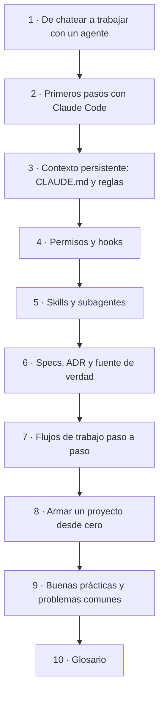
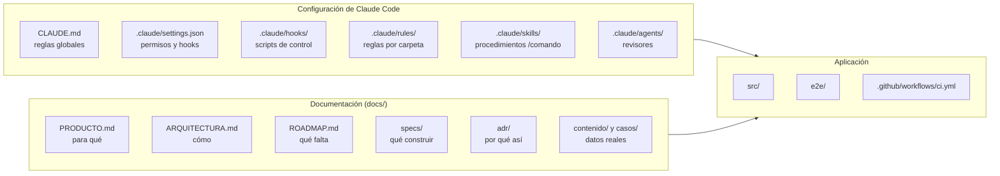

# Guía: desarrollar con un agente de IA

Esta guía explica, desde cero, cómo se trabaja en este repositorio con
**Claude Code**, un asistente de IA que no solo conversa sino que lee el
proyecto, ejecuta comandos y edita archivos. Está pensada para alguien que ya
programa (React, Node, Laravel) y que usó la IA solo como chat: preguntar,
copiar una respuesta y pegarla en el editor.

Al terminarla vas a poder:

- entender qué hace cada archivo de `.claude/` y de `docs/` y por qué existe;
- trabajar con Claude Code en este proyecto sin perder el control;
- armar la misma estructura en un proyecto nuevo.

## Cómo leerla

Los capítulos están en orden: cada uno usa conceptos del anterior. Cada uno
cierra con un resumen y, cuando tiene sentido, una práctica guiada para hacer
en este mismo repositorio. Leerla completa lleva unas dos horas.



| #   | Capítulo                                                               | Pregunta que responde                                         |
| --- | ---------------------------------------------------------------------- | ------------------------------------------------------------- |
| 1   | [De chatear a trabajar con un agente](01-de-chatear-a-un-agente.md)    | ¿Qué cambia cuando la IA puede tocar el proyecto?             |
| 2   | [Primeros pasos con Claude Code](02-primeros-pasos.md)                 | ¿Cómo se instala, se abre y se le pide algo bien?             |
| 3   | [Contexto persistente: CLAUDE.md y reglas](03-contexto-persistente.md) | ¿Cómo sabe Claude las reglas del proyecto en cada sesión?     |
| 4   | [Permisos y hooks](04-permisos-y-hooks.md)                             | ¿Cómo se garantiza lo que no puede fallar?                    |
| 5   | [Skills y subagentes](05-skills-y-subagentes.md)                       | ¿Cómo se empaquetan procesos y revisiones?                    |
| 6   | [Specs, ADR y fuente de verdad](06-specs-adr-y-fuente-de-verdad.md)    | ¿Cómo se acuerda qué construir y por qué?                     |
| 7   | [Flujos de trabajo paso a paso](07-flujos-de-trabajo.md)               | ¿Qué hago cuando quiero una feature, una experiencia, un fix? |
| 8   | [Armar un proyecto desde cero](08-proyecto-desde-cero.md)              | ¿En qué orden armo todo esto en un repo nuevo?                |
| 9   | [Buenas prácticas y problemas comunes](09-buenas-practicas.md)         | ¿Qué conviene hacer y qué hago cuando algo sale mal?          |
| 10  | [Glosario](10-glosario.md)                                             | ¿Qué significa cada término?                                  |

## Dónde está cada cosa en el repositorio



## Esta guía y el sitio

Hoy la guía vive solo en el repositorio: se lee en el editor o en GitHub, que
muestra los diagramas. No forma parte del sitio publicado.

Está escrita para que, si más adelante se decide publicarla, se pueda
convertir en una sección del portfolio sin reescribirla. La propuesta está en
[`docs/specs/006-guia-ia-en-el-sitio.md`](../specs/006-guia-ia-en-el-sitio.md)
(estado: borrador). Para no romper esa posibilidad, al editarla se respetan
estas convenciones:

- un archivo por capítulo, con número de dos dígitos al principio del nombre;
- un solo título `#` por archivo y un primer párrafo que resume el capítulo;
- diagramas en bloques ` ```mermaid `, sin imágenes externas;
- enlaces relativos entre capítulos y hacia el código;
- nada de datos privados ni de nombres de clientes (las mismas reglas que el sitio).
