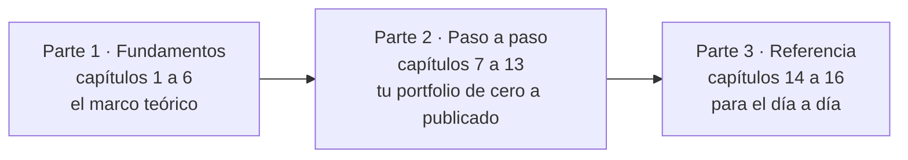
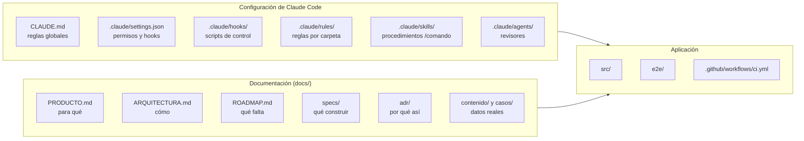

# Hacé tu portfolio con IA — Claude Code

Una guía en español, desde cero, para construir un portfolio profesional como
este trabajando con **Claude Code**, un agente de IA que lee tu proyecto,
ejecuta comandos y edita archivos. Está pensada para quien ya programa (React,
Node.js, Laravel u otro stack) y usó la IA solo como chat.

También se puede leer en el sitio:
https://portfolio-patricio-polito.netlify.app/guia/

## Qué vas a lograr

- **Entender** cómo trabaja un agente de IA y por qué necesita estructura.
- **Construir** tu propio portfolio, paso a paso, con la misma arquitectura.
- **Llevarte el método:** specs, controles automáticos y revisiones, para
  usarlo en cualquier proyecto.

## Cómo está organizada



Si nunca usaste un agente, leé la guía en orden. Si ya conocés Claude Code y
querés ir directo a construir, empezá por el capítulo 7 y volvé a los
fundamentos cuando un paso no te cierre: cada uno indica qué capítulo
explica su porqué.

### Parte 1 · Fundamentos

| #   | Capítulo                                                               | Pregunta que responde                                     |
| --- | ---------------------------------------------------------------------- | --------------------------------------------------------- |
| 1   | [De chatear a trabajar con un agente](01-de-chatear-a-un-agente.md)    | ¿Qué cambia cuando la IA puede tocar el proyecto?         |
| 2   | [Primeros pasos con Claude Code](02-primeros-pasos.md)                 | ¿Cómo se abre una sesión y cómo se pide algo bien?        |
| 3   | [Contexto persistente: CLAUDE.md y reglas](03-contexto-persistente.md) | ¿Cómo sabe Claude las reglas del proyecto en cada sesión? |
| 4   | [Permisos y hooks](04-permisos-y-hooks.md)                             | ¿Cómo se garantiza lo que no puede fallar?                |
| 5   | [Skills y subagentes](05-skills-y-subagentes.md)                       | ¿Cómo se empaquetan procesos y revisiones?                |
| 6   | [Specs, ADR y fuente de verdad](06-specs-adr-y-fuente-de-verdad.md)    | ¿Cómo se acuerda qué construir, por qué y con qué datos?  |

### Parte 2 · Paso a paso

| #   | Capítulo                                                      | Resultado                                              |
| --- | ------------------------------------------------------------- | ------------------------------------------------------ |
| 7   | [Preparar el entorno](07-preparar-el-entorno.md)              | Cuentas, herramientas y tu repositorio con Claude Code |
| 8   | [Producto y contenido](08-producto-y-contenido.md)            | Tu objetivo, tu experiencia y tus casos, escritos      |
| 9   | [Proyecto base y calidad](09-proyecto-base-y-calidad.md)      | Astro + React + TypeScript con tests y `/verificar`    |
| 10  | [Claude Code en tu repositorio](10-claude-code-en-tu-repo.md) | Permisos, hooks, skills, revisores y CI                |
| 11  | [Construir el sitio con specs](11-construir-el-sitio.md)      | La home y las páginas, fase por fase                   |
| 12  | [Casos de estudio y demos](12-casos-y-demos.md)               | Tus casos publicados y, si querés, una demo            |
| 13  | [Publicar y mantener](13-publicar-y-mantener.md)              | El sitio en internet y un circuito para mantenerlo     |

### Parte 3 · Referencia

| #   | Capítulo                                                       | Para qué                                                 |
| --- | -------------------------------------------------------------- | -------------------------------------------------------- |
| 14  | [Flujos de trabajo](14-flujos-de-trabajo.md)                   | Qué hacer para una feature, una experiencia o un arreglo |
| 15  | [Buenas prácticas y problemas comunes](15-buenas-practicas.md) | Hábitos y qué hacer cuando algo sale mal                 |
| 16  | [Glosario](16-glosario.md)                                     | Cada término, con dónde aparece en el repo               |

## Dónde está cada cosa en el repositorio



## Esta guía y el sitio

La guía tiene una sola fuente: estos archivos. Las páginas de `/guia/` del
portfolio se generan a partir de ellos en cada build
([spec 006](../specs/006-guia-ia-en-el-sitio.md)). Para que eso siga
funcionando, al editarla:

- un archivo por capítulo, con número de dos dígitos al principio del nombre
  (`NN-slug.md`); el slug es la URL (`/guia/slug/`);
- un solo título `#` por archivo y un primer párrafo que resume el capítulo
  (es la descripción de la página);
- cada diagrama en un bloque ` ```mermaid ` con una línea `accTitle:` (su
  texto alternativo); después de cambiar uno, `npm run diagramas`
  ([ADR 0006](../adr/0006-diagramas-mermaid-pre-renderizados.md));
- enlaces relativos: a otro capítulo (`02-primeros-pasos.md`) o a archivos del
  repo (`../../CLAUDE.md`, que en el sitio apuntan a GitHub);
- si se agrega un capítulo, se ubica en su parte en `src/data/guia.ts`;
- nada de datos privados ni de nombres de clientes.
